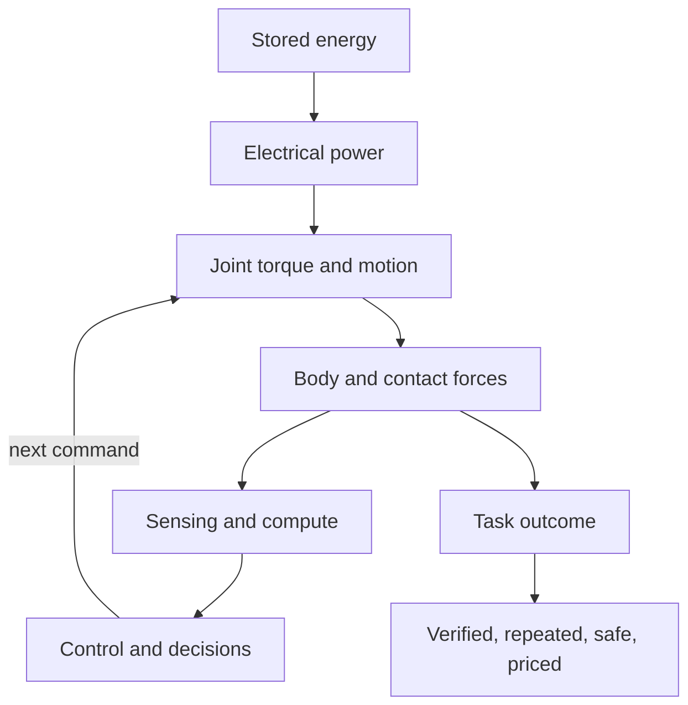

[[index|Home]]

**Scope.** This chapter states the question the library answers, lays out the chain of links between a battery and a finished customer task, defines what "useful" means here, introduces the two recurring cases, and explains how to read the rest of the library. It makes no claims about specific robots beyond the dated evidence already recorded in the [[Deployment Tracker]]. Numbers in worked examples are **illustrative estimates**.

## 1.1.1 The Question This Library Answers

> What has to happen between drawing power from a battery and completing a customer's task safely, repeatedly, and at a competitive cost?

A humanoid robot that walks across a stage, or folds a shirt in a video, has shown that something is *possible*. A customer needs more: the task done on their site, by their definition of done, thousands of times, without hurting anyone, for less than the next-best way of doing it. The distance between those two is where most of the engineering lives, and it is what this library maps.

The question breaks into five smaller ones. Each needs different evidence, and a robot can pass one while failing the next.

| Sub-question | What answers it | Main parts |
|---|---|---|
| **Can it physically do the task?** Enough force, reach, speed, precision, runtime | Physics, sizing calculations, bench tests | 2, 3 |
| **Does it do it reliably?** Success rate, recovery, interventions over many attempts | Repeated trials under stated conditions | 3, 4 |
| **Is it safe around people and property?** | Risk assessment, safety functions, standards | 4, 5 |
| **Can it be built, shipped, and serviced at volume?** | Manufacturing, test, and field data | 5 |
| **Is it cheaper per successful task than the alternative?** | Cost models with measured inputs | 6, 7 |

## 1.1.2 The Chain from Watts to Work

Every useful action a humanoid takes is the end of a chain that starts with stored chemical energy. [[1.4 - How a Humanoid Works - The Full System Map|Chapter 1.4]] walks through that chain for a single task; this section names the links and shows where each is covered.

| Link                              | Engineering question                                                                     | Chapters           |
| --------------------------------- | ---------------------------------------------------------------------------------------- | ------------------ |
| Stored energy to electrical power | How much energy, delivered how fast, how safely?                                         | 2.1, 2.2           |
| Electrical power to joint motion  | How much torque and speed per watt, and how much heat?                                   | 2.3, 2.4, 2.5, 2.8 |
| Joint motion to contact forces    | Can the structure and hands apply the right forces in the right places?                  | 2.6, 2.7           |
| Sensing and compute               | What does the robot know, how accurately, and how quickly?                               | 2.9, 2.10          |
| Control and decisions             | How does it turn goals and measurements into motion, and learn new tasks?                | 3.1 to 3.11        |
| Task outcome                      | Is the task well defined, measured, recovered when it fails, and fitted into a workflow? | 4.1 to 4.5         |
| Product                           | Can it be integrated, certified, made, calibrated, and serviced?                         | 5.1 to 5.8         |
| Economics                         | What does a successful task cost, and who pays?                                          | 6.1 to 6.5         |
| Evidence                          | What has actually been demonstrated, and where does it stall?                            | 7.1 to 7.4         |

### Why the weakest link matters (illustrative estimate)

A task succeeds only if every link works on that attempt. As a simplification, treat the links as independent, each with a per-attempt success probability $p_i$. The task success probability is then the product:

$$
P_{\text{task}} = \prod_{i=1}^{n} p_i
$$

where $n$ is the number of links. With seven links each succeeding 99% of the time:

$$
P_{\text{task}} = 0.99^{7} \approx 0.932
$$

So about 7 attempts in 100 fail even though every link looks good on its own. Reaching $P_{\text{task}} = 0.99$ with seven equal links needs each link at

$$
p_i = 0.99^{1/7} \approx 0.9986
$$

Real failures are not independent (a bad pose estimate causes a bad grasp, which causes a recovery), and the number of links depends on how the task is divided. The point survives the simplification: system reliability is set by the whole chain, which is why this library follows the chain end to end rather than treating subsystems in isolation. Chapters 4.2 and 4.3 (Planned) treat success rates and failure statistics properly.

## 1.1.3 What Counts as Useful

In this library a robot does **useful work** when it completes a customer's task:

- **to the customer's definition of done**, verified rather than assumed;
- **safely**, with risks assessed and protective functions independent of task software;
- **repeatedly**, at a measured success rate and intervention rate over a stated period;
- **at a competitive cost**, measured as cost per *successful* task against the simplest alternative that does the same job.

Chapter 4.2 (Planned) turns this into measurable metrics such as successful tasks per scheduled hour, interventions per 100 attempts, recovery time, and energy per successful task. [[1.5 - From Use Case to Engineering Requirements|Chapter 1.5]] (§1.5.5) uses the first of these to set requirements.

### The evidence ladder

Claims about humanoids range from simulation results to repeat orders. The library keeps these stages apart because each one answers a different question:

| Stage | What it shows | What it does not show |
|---|---|---|
| Simulation | The method can work in a model | That it works on hardware |
| Demo | It worked at least once on hardware, often in a prepared setting | Success rate, supervision, or cost |
| Customer pilot | It ran on a customer's task at the customer's site | That the customer will pay for it at scale |
| Paid deployment | A customer pays for it in normal operation | Profitability, or that it beats alternatives |
| Repeat deployment | A customer extended, expanded, or reordered after paying | Performance at other sites |

The current [[Deployment Tracker]] shows how thin even the best public evidence is. Agility Robotics reports a multi-year paid robots-as-a-service agreement with GXO, with Digit moving totes from cobots onto conveyors, and later a cumulative 100,000+ totes ([Agility, 2024-06-27](https://agilityrobotics.com/content/gxo-signs-industry-first-multi-year-agreement-with-agility-robotics); [Agility, 2025-11-20](https://www.agilityrobotics.com/content/digit-moves-over-100k-totes); vendor-reported). BMW reports a ten-month customer pilot of a Figure 02 at Spartanburg, moving 90,000+ sheet-metal parts in about 1,250 operating hours ([BMW Group, 2026-02-27](https://newsroom.bmwgroup.com/global/bmw-group-to-deploy-humanoid-robots-in-production-in-germany-for-the-first-time); customer-reported). Neither source discloses fleet size, supervision, or interventions; the library records those as **Unknown**, not zero.

### Compared with what?

A humanoid is rarely the only way to do a job. Moving totes can be done by conveyors, autonomous mobile robots (AMRs), or a mobile base with an arm. Loading a welding fixture can be done by a fixed industrial robot cell. The humanoid case rests on doing the job in a space built for people without rebuilding the space, and on moving between tasks. Whether that is worth the extra complexity depends on the site, and is tested chapter by chapter rather than assumed. [[1.3 - Why Build a Humanoid|Chapter 1.3]] sets out the argument and its counter-arguments.

## 1.1.4 The Two Running Cases

Two illustrative tasks recur through the library so that every subsystem can be judged by its effect on a real job.

- **Tote transfer (the spine).** Detect a warehouse tote, approach, grasp, lift, carry, place, and verify. It touches every link in the chain, is easy to measure, and has strong simpler alternatives, which makes it an honest test. Used in every chapter.
- **Fixture loading (the contrast).** Take a sheet-metal part from a rack and position it in a welding fixture on a car body-shop line. It demands millimetre placement, handling thin flexible parts, and working at a line's fixed pace near people. Used where the tote is too forgiving: hands (2.7), perception (3.4), contact-rich manipulation (3.8), learning (3.10), and safety (5.3).

[[1.4 - How a Humanoid Works - The Full System Map|1.4]] §1.4.6 walks through one tote cycle and how fixture loading differs, and [[1.5 - From Use Case to Engineering Requirements|1.5]] §1.5.8 sets their illustrative requirements. Neither describes a specific deployment; the dated evidence above shows the closest real ones.

## 1.1.5 How to Read This Library

**Structure.** Seven parts follow the chain: foundations (1), hardware (2), software and control (3), usefulness (4), productization (5), costs (6), and industry evidence (7). Each chapter starts with its scope and ends with related notes and sources, plus open questions where the field has a real unsolved problem to name. Subsystem chapters follow a fixed eight-section pattern (Subsystem Chapter Template).

**Reading paths.**

- *Whole system, fast:* [[1.4 - How a Humanoid Works - The Full System Map|1.4 Full system map]], then 4.5 Warehouse tote transfer and 6.4 Cost per successful task (both Planned).
- *Hardware focus:* 1.4, then Part 2 in order, which follows energy from battery to contact.
- *Control and perception focus:* 1.4, 2.9, 2.10, then Part 3.
- *Evaluating a deployment or purchase:* 1.5, then Parts 4, 6, and 7.

**Evidence labels.** Every quantitative claim carries one of these labels, with its source link next to it:

- *Vendor-reported*: published by the robot's maker.
- *Customer-reported*: published by the organization using the robot.
- *Independently measured*: measured by a party without a stake in the result, or by researchers on their own system with the method described.
- *Illustrative estimate*: a worked number with stated assumptions, for teaching, not evidence.
- *Unknown*: not disclosed. Never treated as zero.

Durable engineering principles and dated industry findings are kept in separate sections, so the principles stay valid when the snapshot ages.

**Notation.** SI units throughout. Energy in joules (J) or watt-hours ($1\ \text{Wh} = 3600\ \text{J}$), power in watts (W). Equations use standard symbols defined where they first appear; specialist terms from any field are defined in the text on first use and collected in the [[Glossary]]. The library assumes an engineering background but no particular specialty. Sources are listed in the [[Source Index]].

## Open Questions

1. **Which link in the chain is holding humanoids back most today: hardware, control, task definition, safety certification, or cost?** Chapter 7.3 (Planned) weighs the evidence.

## Related Notes

- [[index|Home]]
- [[1.4 - How a Humanoid Works - The Full System Map|1.4 How a Humanoid Works: The Full System Map]]
- [[Deployment Tracker]]
- [[Glossary]]
- [[Source Index]]
- Next in Part 1: [[1.2 - What Is a Humanoid Robot|1.2 What Is a Humanoid Robot?]]; [[1.3 - Why Build a Humanoid|1.3 Why Build a Humanoid?]]; [[1.5 - From Use Case to Engineering Requirements|1.5 From Use Case to Engineering Requirements]]
- Running cases and economics: 4.5 Case Study: A Warehouse Tote Transfer (Planned); 6.4 Cost per Successful Task and Return on Investment (Planned)

## Sources

- Agility Robotics (2024-06-27). *GXO Signs Industry-First Multi-Year Agreement with Agility Robotics.* https://agilityrobotics.com/content/gxo-signs-industry-first-multi-year-agreement-with-agility-robotics ([[Source Note - Agility Robotics 2024 GXO Multi-Year Agreement]])
- Agility Robotics (2025-11-20). *Digit Moves Over 100,000 Totes in Commercial Deployment.* https://www.agilityrobotics.com/content/digit-moves-over-100k-totes ([[Source Note - Agility Robotics 2025 Digit 100000 Totes]])
- BMW Group (2026-02-27). *BMW Group to deploy humanoid robots in production in Germany for the first time.* https://newsroom.bmwgroup.com/global/bmw-group-to-deploy-humanoid-robots-in-production-in-germany-for-the-first-time ([[Source Note - BMW Group 2026 Humanoid Robots in Production]])
