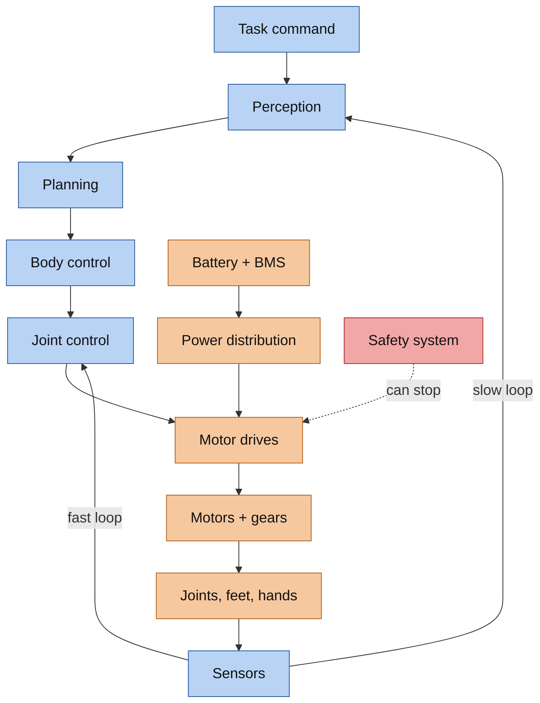

[[index|Home]]

**Scope.** This chapter is a high-level map of how a humanoid robot works. It covers:

- the main subsystems;
- how energy and information move through them;
- how the robot balances and handles objects;
- what happens when something goes wrong.

It ends with one tote-transfer cycle walked through from start to finish. Each subsystem is named and pointed to the chapter that covers it in depth; nothing is sized here. The chapter is hardware-agnostic. Times are **illustrative estimates**.

## 1.4.1 The Subsystems

A humanoid is a set of subsystems that each do one job and depend on all the others. The map below shows how they connect.

The diagram uses three colours:

- **Orange** is the energy path.
- **Blue** is the information path.
- **Red** is the safety system, which works independently of the task software.

The two paths meet at the motor drives, which turn a command from the controllers into current drawn from the battery.

| Subsystem | What it does | In depth (Planned) |
|---|---|---|
| Structure and joints | Rigid links (thigh, shin, forearm) connected by joints, about 30 in a typical layout ([[1.2 - What Is a Humanoid Robot\|1.2]] §1.2.2). Must be light and stiff, carry the payload, and survive a fall. | 2.6 |
| Actuators | Drive each joint: an electric motor, a **transmission** that trades motor speed for torque (gearbox, belt, or screw), and an encoder that measures the joint angle. Much of the robot's mass, cost, and heat. | 2.4, 2.5 |
| Hands | End effectors, from simple grippers to multi-fingered hands ([[1.2 - What Is a Humanoid Robot\|1.2]] §1.2.4). | 2.7 |
| Battery | Stores the energy. Its **battery management system (BMS)** watches cell voltage, current, and temperature and keeps the pack within safe limits. | 2.1 |
| Power distribution | Fuses, switches, voltage converters, and wiring that carry power to every load. | 2.2 |
| Motor drives | Power electronics (inverters) that turn the battery's direct current into the controlled current each motor needs. | 2.3 |
| Sensors | Cameras and depth sensors to see; an **inertial measurement unit (IMU)**, accelerometers and gyroscopes that sense tilt and motion; joint encoders; force/torque sensors at wrists and ankles. All calibrated and time-stamped against one clock. | 2.9 |
| Compute | Real-time controllers near the joints for the fast loops, a more powerful computer for perception and planning, and the network between them. | 2.10 |
| Software layers | The stack of programs that turns a task into motor current (§1.4.3). | Part 3 |
| Safety system | Detects hazardous conditions and brings the robot to a safe state, designed and checked separately from the task software (§1.4.5). | 5.3 |

## 1.4.2 How Energy Moves

Energy flows one way: from the battery, through power distribution and the motor drives, into the motors, through the transmissions, and out as joint motion. Every stage turns some of it into heat: resistance in the battery, cables, and motor windings, switching in the drives, and friction in the gears. How much each stage loses depends on how hard it is working. One open-source humanoid's 3D-printed gearbox measured "approximately 90%" efficient across most conditions, with efficiency dropping at high torque and speed ([Chi et al. 2025](https://doi.org/10.15607/RSS.2025.XXI.062); author-measured; see [[Source Note - Chi 2025 Berkeley Humanoid Lite]]). The heat has to leave the robot. A joint's temperature, more often than its peak torque, limits how long it can work hard ([[2.8 - Thermal Management and Energy Budgets|2.8]]).

The key point for the whole system is that **a humanoid spends most of its energy just being on and upright, not on the task**:

- **Always on.** Computers, sensors, and cooling draw power the whole time the robot is on.
- **Standing.** A biped's leg motors push against gravity just to stand. A joint that holds a load draws current even when it is not moving.
- **Walking.** Walking adds more on top of that.

Lifting the tote, the part the customer pays for, is small by comparison. Battery life is therefore set by the whole shift, including standing, walking, and waiting, not by the task motions. Chapter [[2.1 - Battery Packs Battery Management and Charging|2.1]] puts numbers on this.

Two different quantities set the size of the power system:

- **Energy**, the total amount used over the shift, sets the size of the battery.
- **Power**, the rate of use, sets the size of the drives, the wiring, and the battery's current rating, because the peak power while accelerating or lifting is much higher than the average.

([[2.1 - Battery Packs Battery Management and Charging|2.1]] and [[2.8 - Thermal Management and Energy Budgets|2.8]])

## 1.4.3 How It Senses and Decides

The robot's software is built in layers. Higher layers decide *what* to do and run slowly; lower layers decide *exactly how* to move and run fast. The rates are typical orders of magnitude, not a specification.

| Layer | Job | Typical rate |
|---|---|---|
| Task layer | Receives the order (which object, from where, to where) from the site's system, steps through the phases of the task, and chooses what to do if one fails | Per task or per event |
| Perception and state estimation | Works out where the robot, the object, and the target are | 10–100 Hz perception; 100–1,000 Hz state estimation |
| Motion planning | Plans collision-free paths for the feet, hands, and torso | 1–10 Hz |
| Whole-body control | Turns the planned paths into commands for every joint, while keeping the robot balanced | 100–1,000 Hz |
| Joint control | Sets each motor's current so its joint follows its command | 1–40 kHz for the innermost current loop |

Terms in the table:

- **State estimation** combines sensor readings into a best estimate of the robot's own position, orientation, and velocity, and of the objects around it.
- **Whole-body control** computes all the joint commands together, because moving one arm shifts the balance of the whole body.
- Each joint command is a **setpoint**, the target value a controller drives toward.
- The **current loop** is the innermost controller. It sets motor current, and so torque, thousands of times a second.

**Why fast and slow loops?** The robot's physics sets the pace. Balance and contact forces can change within milliseconds, so the loops that protect them have to be fast and simple. Recognizing an object or planning a path takes longer, and that is acceptable as long as the fast loops keep the robot stable in between. The sensors therefore feed two loops at once, as the diagram in §1.4.1 shows: a fast loop into joint control and a slow loop into perception. **Latency**, the delay between a measurement and the action that uses it, matters most in the fast loops. The slow layers must be able to tell when their data has gone stale. **Middleware**, the messaging software that passes data between programs, carries much of this traffic ([[2.10 - Embedded Compute and Real-Time Communications|2.10]]; 3.1, Planned).

## 1.4.4 How It Balances and Handles Objects

A humanoid can only act on the world through what it touches: its feet on the floor and its hands on the object. Its pelvis typically has no motor of its own ([[1.2 - What Is a Humanoid Robot|1.2]] §1.2.2), so the only way it can move or steady its body is by pushing on the world through those contacts.

**Feet push, but cannot pull.** The floor can only push up on a foot. Friction limits how hard the foot can push sideways before it slips. The combined push of the floor acts at one point, the **centre of pressure**, and that point has to stay within the area the feet cover, or the robot starts to tip. With both feet down that area is fairly large. During a step it shrinks to one foot, so walking is a controlled fall that each step catches. (Chapter 3.7, Planned)

**A held object shifts the balance.** Holding a tote out in front moves the **centre of mass** of robot plus tote forward, toward the edge of the feet. The robot compensates by leaning back, stepping closer, or holding the load nearer its body. Speeding the tote up or slowing it down pushes back on the body as well. That is why a humanoid's arms and legs are controlled together, by whole-body control, rather than by separate controllers.

**Hands have to hold on.** A grasp holds an object either by squeezing hard enough for friction to carry its weight or by hooking under an edge such as a tote lip. Which one is better depends on the object ([[2.7 - Hands Grippers and End Effectors|2.7]]).

**Force sensing closes the loop.** Force/torque sensors at the wrists and ankles report what the contacts are actually doing. When the tote touches the shelf, the wrist sensor feels it before a camera could see it. When the load shifts, the ankle sensors see the centre of pressure move. Some controllers also use **impedance control**: they tell a joint how stiff and springy to be instead of demanding an exact position, so it gives way gently on contact (Chapters 3.3 and 3.8, Planned).

## 1.4.5 When Things Go Wrong

There are two very different kinds of response, and they must be kept separate.

**Task recovery** is ordinary software. The task layer notices the task is not succeeding, for example because the grasp slips, the object is not where it was expected, or the shelf slot is blocked, and tries something else. For example, if the wrist sensor shows the tote twisting in the gripper, the robot sets it down, looks again, and re-grasps. Retries are capped so a persistent error cannot loop forever. After that the robot asks for help, either from a remote operator who guides it through **teleoperation** (control through a remote interface) or from a worker on the floor. Any such human help is an **intervention**, and it is logged. Recovery serves productivity, and it can be as clever as the software allows. (Chapter 4.3, Planned)

**A protective safety response** is a safety function, such as a **protective stop**. It is triggered by a hazardous condition, such as a person too close, excess speed or force, or a fault in the robot. It runs on separately designed and checked hardware and software, is deliberately simple, and must not depend on the task software being correct.

**Legs make stopping harder.** A fixed arm or a wheeled base can simply cut motor power and stay where it is. A biped that loses power falls ([[1.2 - What Is a Humanoid Robot|1.2]] §1.2.3). Its "stop" has to be a controlled move to a safe posture, such as crouching or kneeling, and enough power has to remain available to get there. Vendors are open that this is unfinished. Agility says of Digit 5 that "Certain safety features are still in development" ([Agility, Digit 5 page](https://www.agilityrobotics.com/solutions/digit-5); vendor-reported; see [[Source Note - Agility Robotics Digit 5 Product Page]]). How safety standards apply to mobile, legged robots is covered in Chapter 5.3 (Planned).

## 1.4.6 One Cycle, Walked Through

The tote-transfer case ([[1.1 - Introduction - From Watts to Work|1.1]] §1.1.4) goes like this. The robot takes a **tote**, a reusable plastic storage bin, from a conveyor. It carries the tote about 10 m, places it on a shelf, and walks back.

- **Start.** The warehouse management system knows which tote to move, but nobody knows its exact **pose** (position and orientation). The robot is standing and charged, knows where it is in the aisle, and has an empty gripper.
- **End.** The tote sits upright in the right shelf slot, within tolerance, with its contents undisturbed, and the robot is balanced and ready for the next order.
- **Attempt.** One **attempt** runs from accepting the order to a verified success, an abort, or a hand-off to a person. Retries belong to the same attempt.

One way the cycle could run:

| Phase | Time (s) | What happens | Subsystems carrying it |
|---|---|---|---|
| Walk to conveyor | 10 | Walk 10 m at about 1.0 m/s | Legs, balance, localization |
| Perceive and align | 7 | Find the tote, estimate its pose, step into position | Cameras, perception, foot placement |
| Grasp | 6 | Reach, close the gripper, confirm the grasp | Arms, hand, wrist force sensing |
| Lift | 2 | Raise the tote clear of the conveyor | Shoulders, whole-body control |
| Carry | 13 | Walk 10 m at about 0.8 m/s, slower with the load | Legs, balance with a shifted centre of mass |
| Align at shelf | 6 | Find the slot, step and lean into reach | Perception, whole-body control |
| Place | 7 | Lower the tote into the slot, feel contact, release | Arms, wrist force sensing, compliant control |
| Verify and withdraw | 6 | Check the placement, pull the gripper clear | Cameras, task layer |
| Report | 3 | Report the result and accept the next order | Task layer, site network |
| **Total** | **60** | | |

This is an illustrative estimate, not a measurement. Two things stand out:

- About two-fifths of the cycle is walking.
- Only about 2 s is the lift that most people picture when they think of the task.

A single re-grasp would add several seconds. [[1.5 - From Use Case to Engineering Requirements|1.5]] §1.5.5 turns a customer throughput target into a limit on cycle time and checks this 60 s estimate against it.

**Fixture loading** is the contrast case. The robot places a sheet-metal part into a welding **fixture**, a rigid holder that clamps parts in exact position, in a car **body shop**, the area of a plant where panels are welded into the car body. The same subsystems do the work, but the pressure moves:

- **Walking.** The walk is only a few metres.
- **Pace.** The production line sets the pace, so there is no freedom to run slow.
- **Placement.** It has to be about ten times tighter. The illustrative requirement sets in [[1.5 - From Use Case to Engineering Requirements|1.5]] §1.5.8 assume ±1 mm here against ±10 mm for the tote. That tightens perception, calibration, and control.
- **Handling.** The part is thin, flexible, and sharp, and it has to be seated on locating pins. Gentle, force-controlled insertion matters more than strength.
- **Failure.** A miss can stop the line, so far fewer failures are allowed.

## Related Notes

- [[index|Home]]
- Previous: [[1.3 - Why Build a Humanoid|1.3 Why Build a Humanoid?]] · Next: [[1.5 - From Use Case to Engineering Requirements|1.5 From Use Case to Engineering Requirements]]
- [[1.1 - Introduction - From Watts to Work|1.1 Introduction: From Watts to Work]] · [[1.2 - What Is a Humanoid Robot|1.2 What Is a Humanoid Robot?]]
- [[Glossary]] · [[Source Index]]
- Energy and hardware: [[2.1 - Battery Packs Battery Management and Charging|2.1]], [[2.2 - Power Distribution and Protection|2.2]], [[2.3 - Motor Drives and Power Electronics|2.3]], [[2.4 - Motors and Actuator Selection|2.4]], [[2.5 - Transmissions and Joint Modules|2.5]], [[2.6 - Mechanical Architecture and Structures|2.6]], [[2.7 - Hands Grippers and End Effectors|2.7]], [[2.8 - Thermal Management and Energy Budgets|2.8]]
- Sensing, compute, and software: [[2.9 - Sensors Calibration and Time Synchronization|2.9]], [[2.10 - Embedded Compute and Real-Time Communications|2.10]]; 3.1, 3.3, 3.4, 3.5, 3.6, 3.7, 3.8, 3.9 (Planned)
- Failure and safety: 4.3, 5.3 (Planned)
- Running case in depth: 4.5 Case Study: A Warehouse Tote Transfer (Planned)

## Sources

- Chi, Y. et al. (2025). *Demonstrating Berkeley Humanoid Lite: An Open-source, Accessible, and Customizable 3D-printed Humanoid Robot.* RSS XXI. https://doi.org/10.15607/RSS.2025.XXI.062 ([[Source Note - Chi 2025 Berkeley Humanoid Lite]])
- Agility Robotics. *Digit 5* product page. https://www.agilityrobotics.com/solutions/digit-5 ([[Source Note - Agility Robotics Digit 5 Product Page]])
