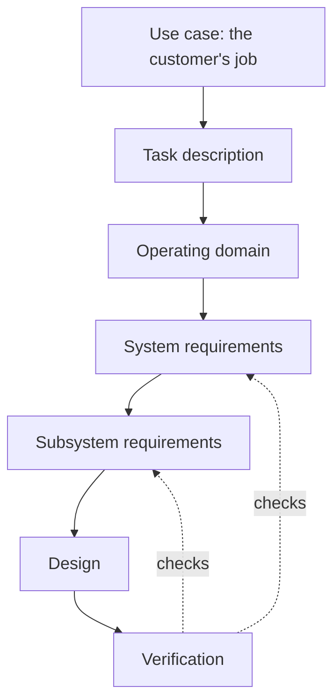

[[index|Home]]

**Scope.** This chapter shows how a customer's job becomes engineering requirements that a design can be sized against and a test can pass or fail. It covers:

- where requirements come from;
- how to write a good one;
- how to bound the conditions it must hold in;
- the kinds of requirements a humanoid needs;
- how system requirements flow down to subsystems;
- the trade-offs and common mistakes;
- how each requirement is verified.

It ends with two requirement sets, one per running case, that later chapters size against. The chapter is about the process; the sizing itself happens in Part 2. Requirement values are **illustrative assumptions** unless a source sits next to them.

## 1.5.1 From a Customer's Job to Requirements

A customer describes a job in plain words: move these, load that, keep up with the line. Engineering needs numbers that a design can be sized against and a test can pass or fail. The path between the two looks like this:

**Needs and requirements are different things.** A *need* is what the customer wants in their own terms: "keep the outbound conveyor fed during the night shift." A *requirement* is a precise, testable statement the engineering team commits to: a rate, a range of objects, a tolerance, the conditions, and how it will be checked. Turning one into the other is mostly a job of asking questions:

- Which objects?
- How many per hour?
- What counts as done?
- What happens when it goes wrong?
- Who else is nearby?

**Requirements come from several people, not just the buyer:**

- **The customer or site manager** gives the task, the rate, and what counts as done.
- **Site operations** know the layout, how work arrives, the shift pattern, and the systems the robot must talk to.
- **Safety and health staff** set who may work near the robot and under what rules.
- **Maintenance staff** set how the robot is charged, cleaned, repaired, and replaced.
- **The robot's own engineering team** adds what the product needs to be buildable, serviceable, and certifiable (Part 5).

A requirement set that hears only from the buyer usually fails on the shop floor.

## 1.5.2 Writing a Good Requirement

NASA's systems engineering handbook gives a widely used checklist ([NASA SE Handbook, Appendix C](https://www.nasa.gov/seh/appendix-c-how-to-write-a-good-requirement); see [[Source Note - NASA Systems Engineering Handbook]]). In short, a requirement should be:

- **Mandatory and clearly worded.** "**Shall** = requirement", "**Should** = goal", "**Will** = facts or declaration of purpose".
- **Quantified**, "complete with tolerances" for performance values.
- **Verifiable**: "Can the system be tested, demonstrated, inspected, or analyzed to show that it satisfies requirements?"
- **Traceable**: "bidirectionally traceable to higher-level requirements", and "stated in such a manner that it can be uniquely referenced" (that is, given an ID).

A general example of the difference:

| Weak | Better |
|---|---|
| The robot shall handle heavy objects quickly and accurately. | REQ-12: The robot shall pick objects of 0.5 to 10 kg from surfaces 0.3 to 1.2 m above the floor and place them within ±10 mm of the target position, at no less than 45 successful placements per scheduled hour, within the operating domain defined in REQ-1 to REQ-8. |

The weak version cannot fail a test. The better one names the range, the tolerance, the rate, the denominator (*scheduled* hours, so downtime counts against the robot), and the conditions.

**State the need, not the solution.** "The robot shall reach shelves 0.4 to 1.0 m high and cross a 20 mm floor threshold" is a requirement. "The robot shall have legs" is a design decision, made later and justified against requirements like those. Writing the solution into the requirements decides the design before anyone has compared options, which is exactly the comparison [[1.3 - Why Build a Humanoid|1.3]] §1.3.4 says must be made.

## 1.5.3 The Operating Domain

The **operating domain** is the set of conditions under which the requirements must hold. Writing it down early prevents the most common requirements failure: a robot that meets every number in the lab and fails on the first unusual object at the site.

| Domain aspect | What to specify |
|---|---|
| Objects | Mass range, dimensions, shape, surface (smooth, reflective, deformable), condition (damaged, wet), how they are presented (pose spread) |
| Places | Pick and place heights, reach distances, clearances, fixture or shelf geometry |
| Floor and route | Surface, slope, steps or thresholds, route length, congestion |
| Environment | Lighting, temperature, dust, noise, wireless coverage |
| People | Who is nearby, how close, how often, and in what roles |
| Workflow | How tasks arrive, what the robot reports back, what happens upstream and downstream |
| Duty cycle | Shift length, breaks, charging windows, scheduled hours per week |

Each line should be a range drawn from the site, not a single ideal value. The spread matters as much as the limits: a robot sized for the average object fails on the heaviest, and one tested only under good lighting fails at dusk.

**Outside the domain** the robot is not expected to succeed, but it is expected to notice. A tote far heavier than the stated range, a blocked aisle, or a person where none should be are reasons to stop and ask for help, not to try anyway ([[1.4 - How a Humanoid Works - The Full System Map|1.4]] §1.4.5). Detecting "this is outside my domain" is itself a requirement (Chapter 4.1, Planned).

## 1.5.4 Kinds of Requirements

A complete set covers more than performance. Each kind has a natural owner, who should review it.

| Kind | What it covers | Humanoid example | Usually owned by |
|---|---|---|---|
| Performance | What the task needs: rate, payload, reach, precision, success rate | ≥ 45 successful transfers per scheduled hour | Customer, site operations |
| Interface | What the robot exchanges with the site: task orders, status, signals, physical fittings | Receives orders from and reports to the warehouse management system | Site IT, line controls |
| Environment | Conditions it must survive and work in | 5 to 35 °C, factory dust, wet floors near doors | Site operations |
| Safety | How it protects people and property | Stops to a safe posture when a person enters a set zone | Site safety staff, standards (5.3) |
| Reliability and availability | How often it fails and how much of the schedule it is usable | Available ≥ 85% of scheduled hours | Customer, maintenance |
| Operations and service | Charging, cleaning, repair, updates, training | Battery swap or charge without a technician | Maintenance |
| Cost | What the customer can pay per task or per year | Cost per successful task below the current method | Customer, finance (Part 6) |

## 1.5.5 Flowing Requirements Down

System requirements say what the whole robot must do. Subsystem requirements say what each part must do so that the whole works. The step between them is mostly calculation, done in the chapter that designs each subsystem. This section shows the pattern.

| System requirement                               | Subsystem requirements it drives                                                                                     | Sized in (Planned) |
| ------------------------------------------------ | -------------------------------------------------------------------------------------------------------------------- | ------------------ |
| Throughput (successful tasks per scheduled hour) | Cycle time, availability, success rate; from those, walking speed, perception time, grasp time                       | 3.6, 3.9, 4.2      |
| Payload and reach                                | Joint torque and speed at the shoulders, waist, and legs; structural strength; continuous torque without overheating | 2.4, 2.5, 2.6, 2.8 |
| Shift length and duty cycle                      | Battery energy, charging time and windows, heat the robot can shed over a shift                                      | 2.1, 2.8           |
| Placement tolerance                              | An error budget shared among perception, calibration, and control                                                    | 2.9, 3.3, 3.4      |
| People nearby                                    | Speed and force limits, sensing range, safe-stop behaviour                                                           | 5.3                |

**Throughput is the clearest example.** The customer cares about successful tasks per scheduled hour, $R$. The robot delivers that only during the fraction of scheduled time it is available, $A$, and only on the fraction of attempts that succeed without help, $p$. With cycle time $T_c$ in seconds:

$$
R = \frac{3600\, A\, p}{T_c}
$$

The requirement fixes only the combination. A faster cycle can make up for lower availability, and a higher success rate can buy back a slower cycle. The design team chooses how to split it, and then each part becomes a requirement of its own. For the tote set in §1.5.8, the limit is $T_c \le 3600 \times 0.85 \times 0.95 / 45 = 64.6\ \text{s}$. The 60 s cycle walked through in [[1.4 - How a Humanoid Works - The Full System Map|1.4]] §1.4.6 meets it, with little room for a retry.

**Tolerances split the same way.** Placement error comes from several independent sources: perception (where the robot thinks the target is), calibration (where it thinks its own hand is), and control (how closely the hand follows the command). Independent errors add as the square root of the sum of their squares, so the total tolerance becomes an **error budget**, a limit for each source. A tolerance ten times tighter, as in fixture loading, makes every share ten times tighter, which is why that case drives perception and calibration ([[2.9 - Sensors Calibration and Time Synchronization|2.9]] §2.9.4; 3.4, Planned).

## 1.5.6 Trade-offs and Common Mistakes

Requirements pull against each other, and the set has to say which wins:

- **Throughput against success rate.** Moving faster usually means more misses. A fast cycle with frequent retries can deliver less than a slower, surer one.
- **Speed against precision.** Fine placement needs slower, more careful final motion.
- **Payload against mass and energy.** A stronger robot is heavier, which costs energy on every step, including the steps where it carries nothing.
- **Speed against safety.** Working near people usually caps speed and force, which caps throughput.

Writing each requirement as *shall* or *should* (§1.5.2) is how a set records which wins.

Common mistakes:

- **Requirements copied from a demo.** A demo shows what a robot did once, in a prepared setting. It says nothing about rate, spread, or failures ([[1.1 - Introduction - From Watts to Work|1.1]] §1.1.3).
- **Lab-only conditions.** One lighting setup, one object, one clean floor. The operating domain (§1.5.3) exists to prevent this.
- **Missing denominators.** "50 per hour" means little until it says per *scheduled* hour or per *operating* hour, and whether human-assisted successes count.
- **Averages instead of ranges.** A robot built for the average fails on the extremes, and the extremes arrive every shift.
- **Untestable wording.** "Reliably", "quickly", "safely", with no number and no test.

## 1.5.7 Verification and Traceability

**Verification** asks whether the system meets its requirements. NASA's handbook defines it as "a formal process, using the method of test, analysis, inspection or demonstration, to confirm that a system and its associated hardware and software components satisfy all specified requirements" ([NASA SE Handbook, 5.3](https://www.nasa.gov/seh/5-3-product-verification)). Its glossary distinguishes the four methods ([NASA SE Handbook, Appendix B](https://www.nasa.gov/reference/appendix-b-glossary/)):

| Method | NASA definition (abridged) | Example for a humanoid |
|---|---|---|
| Test | "The use of a realized end product to obtain detailed data to verify or validate performance" | Measuring placement error over 500 placements with an external tracking system |
| Analysis | "Use of mathematical modeling and analytical techniques to predict the compliance of a design to its requirements" | Calculating joint torque or shift energy from the requirement values |
| Inspection | "The visual examination of a realized end product" | Checking that a guard, label, or emergency stop is fitted |
| Demonstration | "Showing that the use of an end product achieves the individual specified requirement" | Running a full shift at the site and recording that it completed |

**Traceability** links each requirement to its parent (why it exists) and to its verification (how it is checked). A small example from the tote set:

| ID | Requirement (short) | Parent | Verified by | Sized in |
|---|---|---|---|---|
| T-4 | ≥ 45 successful transfers per scheduled hour | Customer use case | Demonstration at site | 4.2 |
| T-5 | Cycle time ≤ 64 s | T-4, T-6, T-7 | Test | 3.6, 3.9 |
| T-8 | Full shift on battery plus charging plan | T-7, T-11 | Analysis, then test | 2.1, 2.8 |
| T-3 | Placement within ±10 mm | Customer use case | Test | 2.9, 3.4 |

When a requirement changes, traceability shows everything downstream that must be re-checked.

## 1.5.8 Requirement Sets for the Two Running Cases

These are the inputs later chapters size against. **Basis** says where each value comes from: *Assumed* (an illustrative choice), *Derived* (calculated from other rows), or a cited source. They will be revised if site data becomes available.

### Tote transfer

| ID | Requirement | Value | Basis |
|---|---|---|---|
| T-1 | Object | Plastic tote, 0.5 to 10 kg including contents | Assumed |
| T-2 | Pick and place heights | Pick at 0.4 m (conveyor); place at 0.4 to 1.0 m (shelf) | Assumed |
| T-3 | Placement tolerance | ±10 mm in position | Assumed |
| T-4 | Throughput | ≥ 45 successful transfers per scheduled hour | Assumed |
| T-5 | Cycle time | ≤ 64 s per attempt | Derived from T-4, T-6, T-7 (§1.5.5) |
| T-6 | Success without intervention | ≥ 95% of attempts | Assumed |
| T-7 | Availability | ≥ 85% of scheduled hours | Assumed |
| T-8 | Shift energy | A full 8 h shift, met by battery plus a charging plan | Assumed; sized in 2.1 |
| T-9 | Walking distance | About 20 m per cycle | Assumed (as in 1.2) |
| T-10 | Floor and people | Flat indoor floor; aisles shared with workers | Assumed |
| T-11 | Shift | 8 h | Assumed |
| T-12 | Interfaces | Receives tasks from, and reports results to, the warehouse management system (WMS) | Assumed |

### Fixture loading

| ID | Requirement | Value | Basis |
|---|---|---|---|
| F-1 | Object | Sheet-metal part, 1 to 8 kg, up to 1.2 m long, thin with sharp edges | Assumed |
| F-2 | Placement tolerance | ±1 mm in position, onto fixture locating pins | Assumed; BMW describes its pilot's placement only as "millimetre precision" (qualitative) |
| F-3 | Cycle time | Set by the line's takt time; assumed ≤ 60 s | Assumed |
| F-4 | Success without intervention | ≥ 99.5% of attempts, because a miss can stop the line | Assumed |
| F-5 | Shift pattern | Ten-hour shifts, Monday to Friday | BMW pilot pattern ([BMW Group, 2026-02-27](https://newsroom.bmwgroup.com/global/bmw-group-to-deploy-humanoid-robots-in-production-in-germany-for-the-first-time); customer-reported; see [[Source Note - BMW Group 2026 Humanoid Robots in Production]]) |
| F-6 | Walking distance | ≤ 5 m per cycle, rack to fixture | Assumed |
| F-7 | Floor and people | Flat factory floor; line workers nearby | Assumed |
| F-8 | Interfaces | Exchanges part-present and clamp signals with the line controller | Assumed |

**Takt time** is the pace a production line must run at to meet demand: available time divided by required units. Every station on the line, human or robot, must finish within it.

The two sets differ most in three places:

- **Placement tolerance:** ten times tighter for fixtures.
- **Required success rate:** about ten times fewer failures allowed for fixtures.
- **How cycle time is set:** by the customer's throughput target for totes, by the line for fixtures.

Those three differences drive most of the contrast in later chapters.

## Related Notes

- [[index|Home]]
- Previous: [[1.4 - How a Humanoid Works - The Full System Map|1.4 How a Humanoid Works: The Full System Map]]
- [[1.1 - Introduction - From Watts to Work|1.1 Introduction]] · [[1.2 - What Is a Humanoid Robot|1.2 What Is a Humanoid Robot?]] · [[1.3 - Why Build a Humanoid|1.3 Why Build a Humanoid?]]
- [[Glossary]] · [[Source Index]]
- Next: [[2.1 - Battery Packs Battery Management and Charging|2.1 Battery Packs, Battery Management, and Charging]]
- Uses of these requirements: [[2.1 - Battery Packs Battery Management and Charging|2.1]], [[2.4 - Motors and Actuator Selection|2.4]], [[2.8 - Thermal Management and Energy Budgets|2.8]], [[2.9 - Sensors Calibration and Time Synchronization|2.9]]; 3.3, 3.4, 3.6, 3.9, 4.1, 4.2, 5.3, 6.4 (all Planned)

## Sources

- NASA (2016). *NASA Systems Engineering Handbook*, NASA/SP-2016-6105 Rev 2, web edition: §5.3 Product Verification, https://www.nasa.gov/seh/5-3-product-verification ; Appendix B Glossary, https://www.nasa.gov/reference/appendix-b-glossary/ ; Appendix C How to Write a Good Requirement, https://www.nasa.gov/seh/appendix-c-how-to-write-a-good-requirement ([[Source Note - NASA Systems Engineering Handbook]])
- BMW Group (2026-02-27). *BMW Group to deploy humanoid robots in production in Germany for the first time.* https://newsroom.bmwgroup.com/global/bmw-group-to-deploy-humanoid-robots-in-production-in-germany-for-the-first-time ([[Source Note - BMW Group 2026 Humanoid Robots in Production]])
