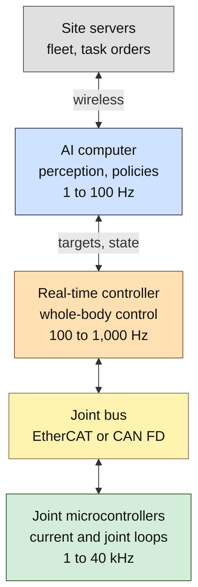

[[index|Home]]

**Scope.** This chapter covers the computers inside a humanoid and the networks between them:

- how computing is split across processors;
- real-time operating systems;
- the buses that connect joints and sensors;
- latency budgets;
- the power that compute draws.

Software architecture and middleware are in 3.1 (Planned). Numbers in worked examples are **illustrative estimates** unless a source sits next to them.

## 2.10.1 Purpose and Interfaces

Compute turns sensor readings into motor commands, fast enough and reliably enough that the robot stays upright and does its task. The network carries those readings and commands between the processors that need them. Both are judged less by their average speed than by their worst case.

- **Energy:** compute and network electronics draw power whenever the robot is on, and all of it becomes heat in the torso ([[2.8 - Thermal Management and Energy Budgets|2.8]] §2.8.2).
- **Data:** sensor streams in ([[2.9 - Sensors Calibration and Time Synchronization|2.9]] §2.9.2), joint commands out, and a link to the site's systems.
- **Commands and feedback:** task orders from the site; status, logs and alarms back.
- **Timing:** each layer's loop rate, its latency, and its **jitter**, the variation in timing from one cycle to the next ([[1.4 - How a Humanoid Works - The Full System Map|1.4]] §1.4.3).
- **Physical:** where the boards sit, how they are cooled, and connectors and cables that survive vibration and falls ([[2.6 - Mechanical Architecture and Structures|2.6]] §2.6.3).

## 2.10.2 Fundamentals

### How compute is split

No single processor does everything. The work is split by how fast it must run and how badly a late answer hurts.

| Tier | Where | Jobs | Typical rate ([[1.4 - How a Humanoid Works - The Full System Map\|1.4]] §1.4.3) |
|---|---|---|---|
| Joint microcontrollers | In or near each joint | Current loop, joint position and velocity loops, local protection | 1 to 40 kHz |
| Real-time controller | Torso | State estimation, whole-body control, watchdogs over the joints | 100 to 1,000 Hz |
| AI computer (GPU or accelerator) | Torso | Perception, learned control policies, task planning | 1 to 100 Hz |
| Site servers (optional) | Off the robot, over wireless | Fleet management, task orders, logging, model updates | Seconds and slower |

TI describes the same split for humanoid motor control: the bandwidth a bus needs depends on "how to split the motor control algorithms between the decentralized motor drive, and the centralized and outer robot motion controller" ([TI SLLA659A](https://www.ti.com/lit/an/slla659a/slla659a.pdf)). Pushing the fast loops down into the joints keeps the traffic on the bus small.

Colour key: grey is off the robot; blue is the AI computer; orange is the real-time controller; yellow is the joint bus; green is the joint microcontrollers. Rates fall going up the diagram, and so does how much harm a late answer does.

### What "real time" means

"Real time" does not mean fast. It means **bounded**: every answer arrives before its deadline, every time. A controller that usually takes 0.2 ms but once an hour takes 5 ms is not real time at 1 kHz, however fast it is on average.

The bound that matters is the **worst-case execution time (WCET)**, the longest a piece of code can take. Wilhelm et al. describe finding upper bounds on it as "a necessary step in the development and validation process for hard real-time systems", and warn that the usual industrial method, measuring the task on test cases, will "in general ... underestimate the WCET and so are not safe for hard real-time systems" ([Wilhelm et al., 2008](https://doi.org/10.1145/1347375.1347389)). The problem is hard on processors with "caches, pipelines, branch prediction, and other speculative components", which describes every fast processor in a humanoid.

**Real-time operating systems.** A general-purpose operating system shares the processor fairly. A real-time one runs the most urgent task first. The Linux kernel documentation puts the difference plainly: under the default policy "the policy does not guarantee immediate preemption when a new SCHED_OTHER task becomes runnable", while under a real-time policy "the scheduler immediately selects it for execution if it has a higher priority than the currently running task". The kernel's PREEMPT_RT option makes Linux "fully preemptible, with the exception of a few critical code paths", which "reduces the latency between a high-priority task becoming runnable and its actual execution on the CPU" ([Linux kernel documentation](https://docs.kernel.org/core-api/real-time/theory.html)). A small dedicated real-time OS on a microcontroller goes further: fewer tasks, simpler hardware, and a worst case that can be analyzed.

### Buses

Three families connect the joints and sensors:

- **CAN FD.** Classic CAN is limited to 1 Mbit/s and 8 bytes per message. CAN FD keeps the 1 Mbit/s limit while devices compete for the bus but switches to a faster rate once one device is sending, and carries "up to 64 byte" per message. With a 1:8 ratio between the two rates, it gives "an approximately six times higher throughput" ([CAN in Automation](https://can-cia.org/can-knowledge/can-fd-the-basic-idea)).
- **EtherCAT.** Industrial Ethernet at 100 Mbit/s, built for control. One frame travels through every device in a line; each device "reads the data addressed to it 'on the fly' and inserts its data in the frame as the frame is moving downstream", so one frame serves the whole bus each cycle ([Beckhoff](https://www.beckhoff.com/en-en/products/i-o/ethercat/)). Its distributed clocks hold every device to the same time "with a precision of < 100 ns" ([[2.9 - Sensors Calibration and Time Synchronization|2.9]] §2.9.2).
- **Ethernet with Time-Sensitive Networking (TSN).** A set of IEEE 802.1 standards that add to ordinary switched Ethernet "guaranteed packet transport with bounded latency, low packet delay variation, and low packet loss" ([IEEE 802.1 TSN Task Group](https://1.ieee802.org/tsn/)). It suits the high-bandwidth links, such as cameras to the AI computer.

### Latency budget

Latency is the delay from a measurement to the action that uses it. In the fast loop it adds up from stages: sample the sensor, carry the reading over the bus, estimate the state, compute the command, carry it back, and apply it at the motor. Every stage has a typical time and a worst case, and the loop's deadline has to hold against the sum of the worst cases (§2.10.4).

### Watchdogs

A **watchdog** is a timer that expects to be reset every cycle. If the code that should reset it is late or stuck, the watchdog fires. Each tier watches the one above it: a joint that stops receiving commands holds or brakes safely on its own, and the real-time controller that stops hearing from a joint, or from the AI computer, moves the robot to a safe posture. The response has to be simple and local, because the thing that failed cannot be relied on to help.

## 2.10.3 Design Alternatives and Tradeoffs

### Buses

| Bus               | Bandwidth                                          | Determinism                                                     | Wiring                                 | Ecosystem                                     |
| ----------------- | -------------------------------------------------- | --------------------------------------------------------------- | -------------------------------------- | --------------------------------------------- |
| CAN FD            | About six times classic CAN's 1 Mbit/s class (CiA) | Good: messages are prioritized; timing depends on load          | Two wires, line topology               | Large; cheap transceivers. Used in automotive |
| EtherCAT          | 100 Mbit/s, over 90% usable (Beckhoff)             | Very good: one master, one frame per cycle, clocks under 100 ns | Line, tree or ring; no switches needed | Large, from factory automation                |
| Ethernet with TSN | 1 Gbit/s and up                                    | Good once configured: bounded latency by standard               | Star, through switches                 | Growing; suits cameras and computers          |

The bandwidth and determinism entries come from the cited sources; the wiring and ecosystem columns and the TSN bandwidth are this library's summary. Beckhoff also notes that a line "is extended to a ring topology for the sake of cable redundancy", which matters in a body where a cable through a hip can break.

**Why not plain Ethernet?** Beckhoff's own example: a drive sending 4 bytes of position and receiving 4 bytes of target in separate Ethernet frames uses "4/84 = 4.8 %" of the link, because the shortest frame is 84 bytes. EtherCAT's one shared frame and TSN's scheduling both exist to avoid that waste and the unpredictable delays of switches and protocol stacks.

### Onboard against offboard compute

| Option | Strength | Weakness |
|---|---|---|
| Everything onboard | Works without the network; lowest latency | All the power and heat are carried; the AI computer sets the battery and cooling |
| Heavy models on site servers | Bigger models; less power and heat on the robot | Wireless latency varies and links drop; the robot must cope when they do |
| Split: control onboard, planning and learning offboard | Uses each where it is strong | Two systems to keep in step |

Some functions must never leave the robot: balance, joint control, the watchdogs and the safety functions ([[1.4 - How a Humanoid Works - The Full System Map|1.4]] §1.4.5). A robot that falls when the Wi-Fi drops is not a product. What can sensibly live offboard is anything that can wait seconds: task orders, fleet coordination, logs, and training.

### Processor choices

| Choice | Strength | Weakness |
|---|---|---|
| Microcontroller certified for functional safety | Simple, analyzable timing; TI lists joint-control microcontrollers "certified for IEC 61508 SIL 3" | Little computing power |
| Real-time processor on a general CPU with a real-time OS | Enough power for whole-body control; mature tools | Worst case must be measured and argued, not proven |
| GPU or AI accelerator | The power that perception and learned policies need | Caches, pipelines and shared memory make worst-case timing hard to bound; hard to certify |

The trade is the same at every tier: the faster the processor, the harder it is to prove when it will finish. That is why the fast, safety-related loops sit on small processors and the big processor's answers are treated as advice that the real-time controller checks.

## 2.10.4 Sizing or Worked Example

All values are **illustrative estimates** unless marked otherwise.

### A 1 kHz control-loop latency budget

Take a robot with 30 joints on EtherCAT, each exchanging 32 bytes of data in each direction per cycle, and a whole-body controller running at 1 kHz, so 1,000 µs per cycle.

**Bus load.** One cycle carries $30 \times 32 = 960$ bytes each way. On the wire that takes

$$
\frac{960 \times 8\ \text{bit}}{100\ \text{Mbit/s}} = 77\ \mu\text{s}
$$

plus about 1 µs of forwarding delay in each of the 30 devices, so about 110 µs in total. The data rate is $960 \times 8 \times 2 \times 1{,}000 = 15.4\ \text{Mbit/s}$: about twice the roughly 8 Mbit/s that TI gives as the usual minimum for humanoid joint buses, and about 15% of EtherCAT's 100 Mbit/s. On CAN FD, at roughly six times classic CAN's 1 Mbit/s class, the same traffic needs at least three separate buses, which is why CAN-based robots usually run one bus per limb.

**The stages.**

| Stage | Typical (µs) | Worst case (µs) |
|---|---|---|
| Sample encoders and currents in the joints | 20 | 20 |
| Bus in | 110 | 110 |
| State estimation | 100 | 150 |
| Whole-body control solve | 400 | 600 |
| Bus out | 110 | 110 |
| Joint applies the command at its next current-loop tick (20 kHz) | 50 | 50 |
| **Total** | **790** | **1,040** |

**What it shows.**

- **The average fits; the worst case does not.** Typical timing leaves 210 µs of margin in a 1,000 µs cycle. A solver that sometimes takes half as long again, from a hard contact case or a cache miss, pushes the total to 1,040 µs and misses the deadline. Testing that only measured averages would pass this design.
- **The bus is not the problem.** Bus transfer is 220 µs of the cycle in both columns, because EtherCAT's timing is fixed by hardware. The variable stages are the software ones, which is where the real-time OS and WCET analysis earn their place (§2.10.2).
- **Fixes are cheap if found early.** Run the solve on a dedicated core, warm-start it from the previous cycle, cap its iterations, or drop the loop to 500 Hz for the arms. Each trades some performance for a bound.

### Compute's share of the 300 W baseline

[[2.1 - Battery Packs Battery Management and Charging|2.1]] §2.1.4 assumed 300 W whenever the robot is on, for standing, compute, sensors and cooling. NVIDIA rates the Jetson T5000, the top module of the Jetson Thor family that Boston Dynamics has announced for Atlas (§2.10.6), at "40 W–130 W" ([NVIDIA](https://www.nvidia.com/en-us/autonomous-machines/embedded-systems/jetson-thor/)). The other items are illustrative.

| Item | Light load (W) | Full load (W) |
|---|---|---|
| AI module (NVIDIA's range) | 40 | 130 |
| Real-time controller | 15 | 15 |
| Joint microcontrollers, 30 at 0.5 W | 15 | 15 |
| Network switches and radio | 5 | 5 |
| **Compute total** | **75** | **165** |
| Share of the 300 W baseline | 25% | 55% |

**What it shows.**

- **Compute can be half the baseline.** With the AI module flat out, compute takes 165 W and leaves 135 W of the 300 W for standing, sensors and cooling. That is tight, so either 2.1's baseline is optimistic for a robot running large models continuously, or the module has to run below its maximum most of the time.
- **The AI module is the swing item.** Everything else is about 35 W. Whether the module idles at 40 W or works at 130 W changes the robot's average draw by 90 W.
- **All of it is torso heat.** 75 to 165 W adds to the heat the torso must shed ([[2.8 - Thermal Management and Energy Budgets|2.8]] §2.8.3).

### Tote hook: compute energy per transfer

Over one 60 s tote cycle, compute uses

$$
75\ \text{W} \times 60\ \text{s} = 1.25\ \text{Wh} \quad \text{to} \quad 165\ \text{W} \times 60\ \text{s} = 2.75\ \text{Wh}
$$

out of the 7.52 Wh per cycle of [[2.8 - Thermal Management and Energy Budgets|2.8]] §2.8.4: 17% to 37% of the energy of every transfer. On 2.8's 7.5 kg pack, that is about 1.2 to 2.7 kg of battery carried to run the computers. Running perception only when the robot needs to look, rather than continuously, is worth up to 1.5 Wh per cycle.

## 2.10.5 Validation and Failure Modes

### Tests

| Test | What it shows | Pass criterion (example) |
|---|---|---|
| Latency and jitter under load | Loop timing with perception, logging and network traffic all running | No missed deadline over a full shift; jitter within a stated bound |
| Worst-case execution time analysis | An upper bound on each real-time task | Bound plus bus time inside the cycle, with margin |
| Fault injection: lost packets | Behaviour when bus frames are dropped or corrupted | Robot holds or stops safely; fault logged |
| Fault injection: crashed process | Behaviour when the AI computer or a program dies | Real-time controller reaches a safe posture on its own |
| Fault injection: unplugged cable | Behaviour when a bus cable is cut mid-motion | Joints beyond the break stop safely; ring redundancy, if fitted, keeps the rest running |
| Watchdog tests | Each watchdog fires and the response follows | Every watchdog proven to trip, not just assumed |
| Thermal soak with compute at full load | Compute temperature over a shift at the site's maximum ambient | No throttling that breaks a deadline ([[2.8 - Thermal Management and Energy Budgets\|2.8]] §2.8.5) |

### Failure modes

| Failure            | How it is detected                          | Safe response                                                                              |
| ------------------ | ------------------------------------------- | ------------------------------------------------------------------------------------------ |
| Missed deadline    | Cycle overrun counter; watchdog             | Hold last safe command for one cycle; repeated misses trigger a controlled stop            |
| Bus fault          | Missing or bad frames; device not answering | Joints hold or brake on their own watchdogs; controlled stop                               |
| Overheating        | Compute temperature sensors                 | Throttle the AI computer first; never the real-time loop; stop before the limit            |
| Software crash     | Heartbeat lost between tiers                | Lower tier takes over: real-time controller reaches a safe posture without the AI computer |
| Wireless link lost | Heartbeat to the site lost                  | Finish or pause the current step safely; wait, then raise an alarm (§2.10.8)               |

## 2.10.6 Industry Progress

Makers announce their AI computers; none found publishes its real-time controller, bus or loop timing.

| Date               | Platform                             | Claim                                                                                                                                      | Evidence stage           | Source                                                                                                |
| ------------------ | ------------------------------------ | ------------------------------------------------------------------------------------------------------------------------------------------ | ------------------------ | ----------------------------------------------------------------------------------------------------- |
| 2025-03-18         | Boston Dynamics Atlas                | "designing in NVIDIA Jetson Thor computing platform"; joint work on "functional safety and security architectures"                         | Vendor-reported          | [Boston Dynamics](https://bostondynamics.com/news/boston-dynamics-expands-collaboration-with-nvidia/) |
| 2025-08-25         | Agility Robotics Digit               | Jetson integrated into the fifth generation; Agility "plans to adopt Jetson Thor as the onboard compute platform for the sixth generation" | Vendor-reported (NVIDIA) | [NVIDIA](https://blogs.nvidia.com/blog/jetson-thor-physical-ai-edge/)                                 |
| Undated            | NVIDIA Jetson T5000 module           | 2,070 TFLOPS at FP4 with sparsity (a peak rating); power "40 W–130 W"                                                                      | Vendor-reported          | [NVIDIA](https://www.nvidia.com/en-us/autonomous-machines/embedded-systems/jetson-thor/)              |
| Undated            | Unitree G1                           | "8-core high-performance CPU"; a "High Computing Power Module ... such as Orin" as an accessory; "WiFi 6"                                  | Vendor-reported          | [Unitree](https://www.unitree.com/g1)                                                                 |
| 2025, revised 2026 | Humanoids in general (supplier view) | Joint interface "either CAN-FD or Ethernet-based (including EtherCAT)"                                                                     | Vendor-reported          | [TI SLLA659A](https://www.ti.com/lit/an/slla659a/slla659a.pdf)                                        |

**What this shows.** The AI tier is converging on one family of GPU modules, rated up to 130 W. The tiers below it, which decide whether the robot stays safe when the AI tier misbehaves, are not described publicly by any maker found.

## 2.10.7 Bottlenecks

- **Large models onboard.** Running large learned models within the robot's power and heat budget: at up to 130 W, the AI module alone can take half the baseline (§2.10.4).
- **Certification.** Showing that safety-related software meets its deadlines on processors whose worst-case timing is hard to bound (§2.10.2). Today's answer is to keep safety on small certified processors and treat the GPU as untrusted, which limits what learned control is allowed to do.

## 2.10.8 Implications for the Tote Transfer Example

- **Energy.** Compute takes 1.25 to 2.75 Wh of each 7.52 Wh cycle, 17% to 37% (§2.10.4). Duty-cycling perception is one of the cheapest energy savings available.
- **Timing.** The 1 kHz whole-body loop needs its worst case, not its average, inside 1 ms. The tote is not demanding on precision, but balance under a tote of up to 10 kg is ([[1.5 - From Use Case to Engineering Requirements|1.5]] §1.5.8).
- **Site link.** If the warehouse network drops mid-cycle, the robot should finish placing the tote it is holding, or set it down safely, and then wait. The task order and the warehouse management system's record of where the tote went can catch up when the link returns ([[1.4 - How a Humanoid Works - The Full System Map|1.4]] §1.4.5). A robot that freezes holding a tote in an aisle blocks the aisle.
- **Simpler alternative.** A conveyor needs one programmable logic controller and no AI computer at all. A fixed robot arm needs the real-time tiers but rarely the GPU, since its perception can be a single camera over a known table.

## Related Notes

- [[index|Home]]
- Previous: [[2.9 - Sensors Calibration and Time Synchronization|2.9 Sensors, Calibration, and Time Synchronization]]
- [[1.4 - How a Humanoid Works - The Full System Map|1.4]] §1.4.3 (layers and rates); [[2.8 - Thermal Management and Energy Budgets|2.8]] §2.8.4 (energy budget)
- [[Glossary]] · [[Source Index]]
- Next: 3.1 Robot Software Architecture and Middleware (Planned)
- Deeper treatment: 3.1 Robot Software Architecture and Middleware, 3.10 Robot Learning and Sim-to-Real Transfer, 5.3 Safety Architecture, Risk Assessment, and Compliance (all Planned)

## Sources

- Texas Instruments (2025, revised 2026). Motor Control in Humanoid Robots, SLLA659A. https://www.ti.com/lit/an/slla659a/slla659a.pdf ([[Source Note - TI SLLA659 Motor Control in Humanoid Robots]])
- Wilhelm, R. et al. (2008). The Worst-Case Execution-Time Problem: Overview of Methods and Survey of Tools. *ACM Transactions on Embedded Computing Systems* 7(3). https://doi.org/10.1145/1347375.1347389 ([[Source Note - Wilhelm 2008 Worst-Case Execution-Time Problem]])
- Linux kernel documentation. Theory of operation (PREEMPT_RT). https://docs.kernel.org/core-api/real-time/theory.html ([[Source Note - Linux Kernel PREEMPT_RT Theory of Operation]])
- CAN in Automation. CAN FD: The basic idea. https://can-cia.org/can-knowledge/can-fd-the-basic-idea ([[Source Note - CiA CAN FD The Basic Idea]])
- Beckhoff Automation. EtherCAT. https://www.beckhoff.com/en-en/products/i-o/ethercat/ ([[Source Note - Beckhoff EtherCAT Technology Page]])
- Beckhoff Automation. EtherCAT Distributed Clocks. https://infosys.beckhoff.com/content/1033/ethercatsystem/2469118347.html ([[Source Note - Beckhoff EtherCAT Distributed Clocks]])
- IEEE 802.1 Time-Sensitive Networking Task Group. https://1.ieee802.org/tsn/ ([[Source Note - IEEE 802.1 TSN Task Group]])
- Boston Dynamics (2025-03-18). Boston Dynamics Expands Collaboration with NVIDIA to Accelerate AI Capabilities in Humanoid Robots. https://bostondynamics.com/news/boston-dynamics-expands-collaboration-with-nvidia/ ([[Source Note - Boston Dynamics 2025 NVIDIA Collaboration]])
- NVIDIA (2025-08-25). NVIDIA Jetson Thor Unlocks Real-Time Reasoning for General Robotics and Physical AI. https://blogs.nvidia.com/blog/jetson-thor-physical-ai-edge/ ([[Source Note - NVIDIA 2025 Jetson Thor]])
- NVIDIA. Jetson Thor product page. https://www.nvidia.com/en-us/autonomous-machines/embedded-systems/jetson-thor/ ([[Source Note - NVIDIA 2025 Jetson Thor]])
- Unitree Robotics. G1 product page. https://www.unitree.com/g1 ([[Source Note - Unitree G1 Product Page]])
