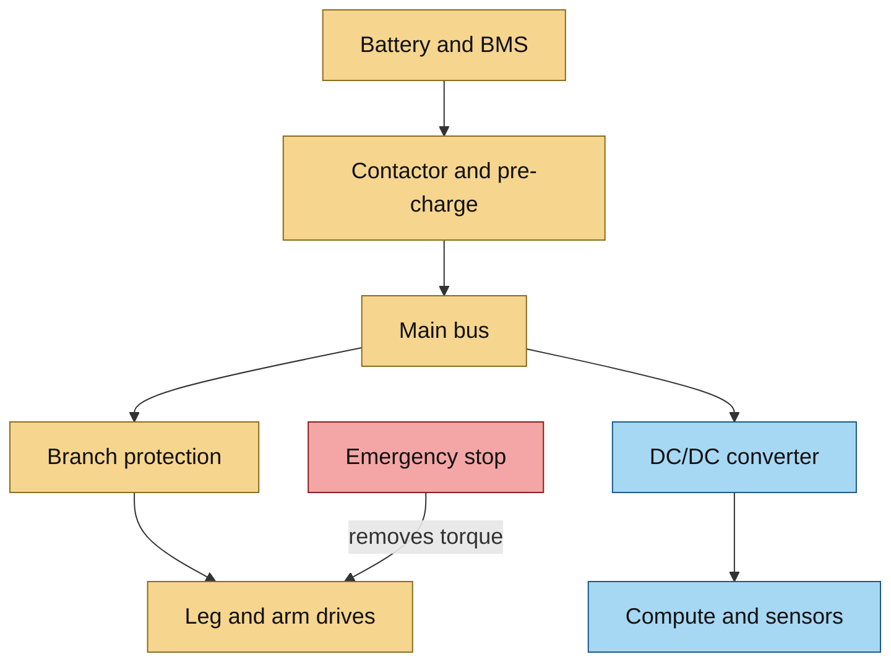

[[index|Home]]

**Scope.** This chapter follows power from the battery terminals to every load in the robot, and covers how faults are contained along the way. Topics:

- the bus voltage;
- voltage conversion for compute and sensors;
- bringing the bus up safely (pre-charge);
- fuses, switches and electronic breakers;
- regenerated energy;
- wiring through moving joints;
- the power paths an emergency stop uses.

The battery itself is in [[2.1 - Battery Packs Battery Management and Charging|2.1]], and the motor drives in [[2.3 - Motor Drives and Power Electronics|2.3]]. Numbers in worked examples are **illustrative estimates** unless a source sits next to them.

**Last reviewed:** 2026-11-22 (passed).

## 2.2.1 Purpose and Interfaces

Power distribution connects one energy source to dozens of loads that draw very different currents, some of them in sudden spikes. It must deliver that power with little loss, keep the voltage within every load's range, and make sure a fault in one branch does not take down the rest of the robot.

- **Energy:** a main bus (the shared supply conductors) whose voltage follows the battery from full to empty and dips further under load. Branch currents range from a few amps for compute to tens of amps for a hip or shoulder drive at peak.
- **Data:** bus voltage and current, branch currents, and fault flags, reported to the robot's computer and the safety system.
- **Commands and feedback:** pre-charge and contactor sequencing at power-up, enabling and disabling branches, and acknowledging faults.
- **Timing:** a short circuit must be cleared in milliseconds or less, before wiring or connectors are damaged and before the bus sags enough to reset other loads.
- **Physical:** the harness, its connectors, and the routing through every rotating joint, all of which add mass and must survive the robot's motion and falls.

The diagram shows a typical layout. Each power branch (one per limb, or one per drive) has its own protection, and the computer and sensors are fed through a separate converter so they stay alive when motor power is removed.

Colour key: yellow is the high-current motor path, blue the low-voltage path for compute and sensors, red the emergency stop.

## 2.2.2 Fundamentals

### Wiring loss and voltage drop

Every conductor has resistance, which wastes power as heat and lowers the voltage that reaches the load:

$$
R = \frac{\rho L}{A}, \qquad V_{\text{drop}} = I R, \qquad P_{\text{loss}} = I^2 R
$$

Here $R$ is the conductor resistance in ohms, $\rho$ the resistivity of the conductor material in $\Omega\,\text{mm}^2/\text{m}$, $L$ the total length of the current path (out and back) in metres, $A$ the cross-section in $\text{mm}^2$, $I$ the current in amps, $V_{\text{drop}}$ the voltage lost along the path, and $P_{\text{loss}}$ the power turned into heat.

For a fixed power $P = V I$, doubling the bus voltage halves the current. Voltage drop halves and loss falls to a quarter. As a semiconductor-company executive puts it, "resistive losses scale with the square of current", so cutting current by four cuts wiring loss by 16 ([Friedrich, The Robot Report, 2026](https://www.therobotreport.com/ai-cant-outrun-a-humanoids-hardware/)). That is the whole case for a higher bus voltage, and §2.2.4 puts numbers on it.

### Voltage conversion

The motor drives run straight from the main bus. Compute, cameras and other sensors need lower, tightly regulated voltages. A **DC/DC converter** produces them by switching the bus voltage on and off at high frequency and filtering the result. Converter losses are small for each converter but run all shift, so they belong in the baseline power budget (2.8, Planned). A converter that feeds compute must also keep working while the bus dips during a current spike, or the computer resets. The lowest bus voltage it must ride through is a requirement, not an afterthought.

### Inrush and pre-charge

Every motor drive has capacitors across its supply to smooth the current it draws. Connecting a discharged capacitor bank straight to a battery produces a huge current surge, limited only by the few milliohms in the path. That surge is **inrush current**. Texas Instruments describes the result in a battery system as "a huge inrush current once the main contactors are closed while the capacitors are fully discharged", and calls pre-charge "mandatory" ([TI SLVAF35A](https://ti.com/document-viewer/lit/html/SLVAF35A/GUID-C085775C-2E48-4FBD-A54F-2AD18E308CB1)). Without it, "welding can occur within the contactor as it closes" ([TI SLVAFB0](https://www.ti.com/document-viewer/lit/html/SLVAFB0)).

**Pre-charge** charges the capacitors slowly first, usually through a resistor, and only then closes the main switch. TI's sequence for a battery system:

1. Close the main negative contactor.
2. Close the pre-charge contactor, which feeds the bus through a current-limiting resistor.
3. Close the main positive contactor once the capacitor voltage reaches "90%–95% of battery pack voltage".
4. Open the pre-charge contactor.

TI notes that "a contactor combined with a current-limiting resistor is the simplest implementation" (both quotes from [TI SLVAF35A](https://ti.com/document-viewer/lit/html/SLVAF35A/GUID-C085775C-2E48-4FBD-A54F-2AD18E308CB1)). The same physics applies to a humanoid's smaller bus, and §2.2.4 sizes a pre-charge resistor for one.

### Protection devices and selectivity

Three kinds of device stop a fault from spreading:

- **Fuse:** a conductor that melts when too much current flows for too long. Simple and cheap, but it acts once and must then be replaced, and its clearing time depends on how large the fault current is.
- **Contactor:** a heavy-duty switch that connects or isolates the battery ([[2.1 - Battery Packs Battery Management and Charging|2.1]] §2.1.1). It can be opened on command by the BMS or the safety system.
- **Electronic fuse (eFuse):** a transistor switch with current sensing that limits or cuts current within microseconds, can be reset, and reports what happened.

**Selectivity** means that only the protection nearest the fault acts. A short in one wrist drive should trip the wrist branch, not the main contactor, so the rest of the robot stays powered and can still bring itself to a safe posture. This requires branch devices that act faster, or at lower current, than the devices upstream of them.

### Regenerated energy

A motor that is slowed down, or that lowers a load under gravity, acts as a generator and pushes current back onto the bus. Drive maker Invertek describes what happens in an industrial drive: the returned energy "charges the capacitor, so the voltage rises". If it keeps coming, the drive trips on overvoltage, which it calls "a symptom of too much regeneration" ([Invertek Drives](https://invertekdrives.com/support/iknow/selection-and-installation/braking-and-regeneration-14)).

The energy has to go somewhere:

- **Into the battery,** if the battery is connected and its BMS allows charging current at that moment.
- **Into the bus capacitors,** which hold only a little energy (§2.2.4).
- **Into a brake resistor as heat.** A transistor switches the resistor across the bus whenever the voltage rises past a threshold. Invertek notes the switching "'chops' the voltage, so it is sometimes called a braking chopper" ([Invertek Drives](https://invertekdrives.com/support/iknow/selection-and-installation/braking-and-regeneration-14)).
- **Into another joint** that is drawing power at the same moment, since all drives share the bus.

Industrial drives on mains power need a brake resistor because their rectifier cannot pass current back to the grid. A battery robot can usually return energy to its battery. The danger is the moment it cannot: a full battery, a BMS that has opened the contactor, or an emergency stop that has disconnected the battery while a limb is still falling.

### Noise and interference

Motor drives switch tens of amps on and off thousands of times per second. Those fast edges radiate and conduct electrical noise. **Electromagnetic compatibility (EMC)** is the discipline of keeping that noise from disturbing other circuits, such as camera links, encoders and communication buses. The basic tools are short current loops, shielded cables for motor phases, a deliberate grounding scheme (one reference point, so return currents do not flow through signal grounds), and filtering at the inputs of sensitive loads.

## 2.2.3 Design Alternatives and Tradeoffs

### Bus voltage class

Lower bus voltage is safer to touch but needs more current and so more copper. Higher voltage saves copper and loss but brings stricter insulation, spacing and safety requirements. The boundary that matters is the extra-low voltage limit set in IEC safety standards (for example IEC 61140). Those standards are paywalled and could not be read, so this library states nothing about their content. The figures below come from vendors and are labelled as such.

| Bus class | Typical use | Advantages | Drawbacks |
|---|---|---|---|
| 24 V class | Small robots, hands and wrists | Simple insulation, wide parts choice | Four times the wiring loss of 48 V at the same power and cable (§2.2.4) |
| 48 V class | Most current humanoids (§2.2.6) | A quarter of the 24 V loss; drives "typically function within the SELV voltage range, which is below 60V" (TI, vendor-reported) | A full pack plus regeneration spikes sits close to 60 V, so parts are rated higher; TI says "components that operate up to 100V are preferable" |
| Above 60 V | Not reported on a humanoid in the sources found | Less current again | Leaves the extra-low voltage range, with stricter protection against touch |

The TI quotes are from [TI SLLA659](https://www.ti.com/document-viewer/lit/html/SLLA659). SELV stands for **safety extra-low voltage**: a circuit kept at a voltage low enough, and separated well enough from higher voltages, that touching it is not considered dangerous under normal conditions.

The two vendor sources disagree in emphasis. TI places 48 V drives within SELV. pSemi engineers writing in Power Systems Design say a non-isolated 48 V bus "often exceeds Safety Extra Low Voltage (SELV) safety limits", and they propose isolated converters downstream for that reason ([McGarry and Kubo, 2026](https://www.powersystemsdesign.com/articles/powering-dexterity-in-humanoid-robots/22/23659)). They give no threshold or standard. A likely reading, not stated by either source, is that a 48 V bus is within the limit at rest but can cross it during charging or regeneration transients. 5.3 (Planned) takes up which standard applies.

### Layout

- **Central distribution:** one protected distribution point in the torso, with a separate cable to every drive. Easy to monitor and service, but many long, heavy cables pass through the hips and shoulders.
- **Distribution per limb:** one heavy feed per limb, with branch protection placed near the drives in that limb. Fewer conductors through the big joints, but protection and monitoring are spread out in tight, hot spaces.
- **Daisy chain:** drives in a limb share one power and communication cable that runs from joint to joint. Lightest and simplest to route, but a fault at one joint can disable every joint further down the chain.

### Wiring through joints

A cable crossing a joint has to bend or twist every time the joint moves. The options:

- **Service loop:** slack cable outside the joint that flexes as it moves. Simple, but exposed, and it can snag.
- **Through a hollow shaft:** the cable runs down the centre of the actuator and twists instead of bending. Protected and compact, but the shaft has to be hollow, which constrains the motor and gearbox ([[2.5 - Transmissions and Joint Modules|2.5]]).
- **Slip ring:** sliding contacts that pass power across a joint that turns without limit. Needed only for continuous rotation, and it adds mass, contact wear and electrical noise.

Most humanoid joints have limited travel, so the first two options cover most of the body.

### Protection devices

| Device | Speed | Resettable | Reports faults | Best fit |
|---|---|---|---|---|
| Fuse | Slow at small overloads, fast at large faults | No | No | Last-resort backup on the main feed and heavy branches |
| Contactor | Tens of milliseconds to open | Yes | Through its controller | Connecting and isolating the battery; safety disconnect |
| eFuse or solid-state switch | Microseconds | Yes | Yes | Branch protection, sequenced power-up, current limiting |

A common combination is a fuse and contactor at the pack, with eFuses on the branches. The fuse is a backup for faults the electronics fail to clear.

### Regenerated energy

| Option | Capacity | Cost and mass | Main risk |
|---|---|---|---|
| Battery accepts it | Large, when connected and allowed to charge | No extra parts | Not available when the pack is full, cold, or disconnected |
| Bus capacitors | A few joules (§2.2.4) | Capacitor mass grows fast with energy | Overvoltage within moments if they are the only path |
| Brake resistor and chopper | Set by resistor rating and duty | Small resistor and switch, but heat to remove | Overheating under repeated braking |
| Another joint uses it | Varies moment to moment | None | Cannot be counted on |

A robot that disconnects its battery as part of a stop needs a brake resistor, or a bus clamp of some kind, so a falling limb cannot drive the bus voltage up. Otherwise the battery is usually enough.

## 2.2.4 Sizing or Worked Example

All values are **illustrative estimates** unless marked otherwise.

### Wiring loss at two bus voltages

**Inputs.** One branch feeding a shoulder drive at a peak of 1,200 W. pSemi engineers give "up to 1200W peak for short durations" for a typical humanoid shoulder ([McGarry and Kubo, 2026](https://www.powersystemsdesign.com/articles/powering-dexterity-in-humanoid-robots/22/23659), vendor-reported). Cable 1.5 m each way (3 m loop), copper, $1.5\ \text{mm}^2$, resistivity $0.0172\ \Omega\,\text{mm}^2/\text{m}$ at 20 °C (standard value for annealed copper).

$$
R = \frac{0.0172 \times 3}{1.5} = 0.0344\ \Omega
$$

| Bus voltage | Current | Voltage drop | Drop share | Loss | Loss share |
|---|---|---|---|---|---|
| 24 V | 50 A | 1.72 V | 7.2% | 86 W | 7.2% |
| 48 V | 25 A | 0.86 V | 1.8% | 21.5 W | 1.8% |
| 39 V (low end of TI's 48 V range) | 30.8 A | 1.06 V | 2.7% | 32.6 W | 2.7% |

**What it shows.** At 24 V the same cable loses four times as much, and 50 A is a great deal for a $1.5\ \text{mm}^2$ cable. To match the 48 V loss at 24 V, the cross-section must grow fourfold to $6\ \text{mm}^2$. The copper in this one 3 m loop then goes from about 40 g to about 161 g (copper density $8.96\ \text{g/cm}^3$). Across a dozen heavy branches, much of it in the limbs where mass costs the most energy, that difference matters. The bottom row shows why a design must be checked at the lowest bus voltage, not at nominal: current is highest when the battery is nearly empty.

### Pre-charge resistor

**Inputs.** Total drive capacitance on the bus $C = 2\ \text{mF}$, full-pack voltage $V = 54\ \text{V}$ (top of the TI range), pre-charge resistor $R_{\text{pc}} = 10\ \Omega$.

$$
\tau = R_{\text{pc}} C = 10 \times 0.002 = 0.020\ \text{s}, \qquad t_{95} = -\tau \ln(0.05) \approx 3\tau = 60\ \text{ms}
$$

Here $\tau$ is the time constant of the resistor and capacitor and $t_{95}$ the time to reach 95% of pack voltage. The peak pre-charge current is $54 / 10 = 5.4\ \text{A}$. The resistor absorbs energy equal to what ends up stored in the capacitors, $\tfrac{1}{2} C V^2 = 0.5 \times 0.002 \times 54^2 = 2.9\ \text{J}$, so a small resistor survives it.

Without pre-charge, with about $20\ \text{m}\Omega$ in the path, the first instant would see about $54 / 0.02 = 2{,}700\ \text{A}$. Closing at 95% leaves a step of $2.7\ \text{V}$, so a brief $135\ \text{A}$ through the same $20\ \text{m}\Omega$. That is why the threshold sits at 90 to 95% and not lower.

### Tote hook: regenerated energy when lowering the tote

Lowering is the lift in reverse. [[2.1 - Battery Packs Battery Management and Charging|2.1]] §2.1.4 puts the lift at 82.4 J of mechanical work: the 10 kg tote through 0.6 m and about 8 kg of arm and torso through 0.3 m. Lowering releases the same 82.4 J at most. Using the same 0.475 battery-to-joint efficiency in reverse, at most about $82.4 \times 0.475 \approx 39\ \text{J}$ reaches the bus. That is $39 / 3600 \approx 0.011\ \text{Wh}$, or about 0.16% of the 6.95 Wh used per cycle. In practice it is often less than zero. A slow lowering keeps current flowing in the motor windings to hold the load, and that copper loss can exceed what the motion returns.

**Where it goes.** With the battery connected, 39 J over a one-second lowering is about 39 W of charging, trivial for the pack. With the battery disconnected, the capacitors must take it alone. Letting the 2 mF bus rise from 54 V to 60 V stores only

$$
\tfrac{1}{2} C \left(V_2^2 - V_1^2\right) = 0.5 \times 0.002 \times (60^2 - 54^2) = 0.68\ \text{J}
$$

so 39 J would drive the voltage far higher. Holding it below 60 V would take about $2 \times 39 / (60^2 - 54^2) = 0.11\ \text{F}$, about 57 times the bus capacitance. The regenerated energy is worth nothing to the energy budget, but it decides whether the robot needs a brake resistor.

## 2.2.5 Validation and Failure Modes

### Tests

| Test | What it shows | Pass criterion (example) |
|---|---|---|
| Voltage drop under a recorded load profile | Lowest voltage at each load during real lifts and steps | Every load stays above its minimum at the end of the battery's range |
| Thermal imaging of harness and connectors | Hot spots under sustained work | Below cable and connector ratings at maximum ambient |
| Short-circuit injection on each branch | That only the faulty branch trips, and how fast | Branch clears within its rated time; compute and other branches stay up |
| Pre-charge and power-up sequencing | Inrush and contactor behaviour, including a failed pre-charge | No contactor welding over many cycles; a stuck contactor is detected |
| Regeneration with the battery disconnected | Bus voltage when a limb falls under gravity | Bus stays below component ratings |
| Flex-life test of cables through joints | Wear over the joint's motion range and cycle count | No conductor breaks or shield damage after the planned life plus margin |
| EMC test | Noise radiated and conducted from drives | Sensors and communication run error-free; emissions within the applicable limits |

### Failure modes

| Failure | Cause | How it is detected | Response |
|---|---|---|---|
| Conductor fatigue at a joint | Repeated bending or twisting | Rising resistance, intermittent faults on that joint | Stop the joint safely; replace the harness section as a service item |
| Loose or worn connector | Vibration, impacts, falls | Heating, voltage drop, intermittent current | Derate or stop; inspect at service |
| Computer brownout | Bus dips during a current spike | Reset logs, undervoltage flags on the converter | Converter that rides through the lowest bus voltage; hold-up capacitance; limit peak current |
| Regeneration overvoltage | Battery disconnected or full while a limb decelerates | Bus voltage monitoring | Brake resistor or clamp; drive limits on regenerated current |
| Branch short circuit | Damaged insulation, failed drive | Overcurrent at the branch protection | Trip that branch only; bring the rest of the robot to a safe posture |
| Contactor welded shut | Inrush without pre-charge, or switching under load | Voltage across the open contactor at power-down | Block power-up until repaired; the fuse remains as backup |

## 2.2.6 Industry Progress

No humanoid maker found publishes its power distribution, branch protection, harness design, or emergency-stop power path. What is published comes from component suppliers describing typical humanoids, plus one vendor battery specification. All of it is vendor-reported and none is independently measured. All pages were accessed on 2026-11-22.

| Date | Source | Claim | Evidence stage | Link |
|---|---|---|---|---|
| 2025-01 to 2026-06 (revision span) | Texas Instruments application brief, no named platform | "typically using 48V nominal voltage with an operating range of approximately 39V to 54V"; drive power from 10 W to 4 kW, "most of the drives between 10W and 1.5kW" | Supplier description of typical designs | [TI SLLA659](https://www.ti.com/document-viewer/lit/html/SLLA659) |
| 2026-05-20 | pSemi engineers in Power Systems Design, no named platform | Two architectures "emerging": a non-isolated 48 V bus, or an isolated, regulated bus that "simplifies the overall safety strategy"; hand and wrist motors on "12V or 24V" | Supplier description of typical designs | [McGarry and Kubo, 2026](https://www.powersystemsdesign.com/articles/powering-dexterity-in-humanoid-robots/22/23659) |
| 2026-09-08 | Allegro MicroSystems executive in The Robot Report, no named platform | Humanoids "are moving toward higher voltages, specifically 48V DC architectures" | Opinion by a supplier executive | [Friedrich, 2026](https://www.therobotreport.com/ai-cant-outrun-a-humanoids-hardware/) |
| Undated (accessed 2026-11-22) | Unitree G1 product page | Power supply a "13 string lithium battery", 9000 mAh, charger "54V 5A" | Vendor specification | [Unitree G1](https://www.unitree.com/g1) |

**What this shows.** The suppliers agree that humanoids have settled on a bus of about 48 V. Unitree does not print its bus voltage. Thirteen lithium-ion cells in series at a typical 3.6 to 3.7 V each would give about 47 to 48 V nominal, consistent with the 54 V charger. That is an inference from the cell count, not a Unitree figure. Nothing published yet says how any named humanoid protects its branches, routes its harness, or handles regenerated energy during a stop.

## 2.2.7 Bottlenecks

- **Wiring reliability.** A humanoid has dozens of joints, each flexing its cables thousands of times a shift, and every flex wears conductors, shields and connectors a little. No humanoid maker has published flex-life or field-failure data. The design problem is getting both power and data through compact joints that move a great deal, without adding mass or making service slow.
- **Stopping a biped without a fall.** An industrial arm can simply cut motor power. A standing biped falls if it does. The emergency-stop path must remove the robot's ability to cause harm while keeping enough controlled power to reach a safe posture, and keeping the computer and sensors alive ([[1.4 - How a Humanoid Works - The Full System Map|1.4]] §1.4.5). How to do both, in a way that can be certified, is still unsettled (5.3, Planned).
- **Safety classification of the bus.** As §2.2.3 shows, suppliers disagree on whether a 48 V humanoid bus stays within extra-low voltage limits in every condition. That affects insulation, enclosure and service-access design.

## 2.2.8 Implications for the Tote Transfer

- **Brownout risk.** The lift is the largest current spike in the cycle. It comes late in a discharge exactly when the battery is at its lowest voltage. The compute converter must ride through that dip, or the robot loses its controller while holding a tote at shelf height.
- **Emergency stop in a shared aisle.** Workers walk the same aisles. An emergency stop must stop the arms and legs from moving in a harmful way without dropping the robot, or the tote, onto someone. That means the stop design is a power-distribution design as much as a software one.
- **Losses.** At the average draw of 417 W from [[2.1 - Battery Packs Battery Management and Charging|2.1]] §2.1.4, a 48 V bus carries about 8.7 A. Through the 0.0344 Ω cable of §2.2.4 that would lose about 2.6 W, about 0.6% of the energy per transfer. This is a crude single-path estimate, but it shows that at 48 V wiring loss is a small share. At 24 V it would be four times as much.
- **Regenerated energy.** Lowering the tote returns at most about 0.01 Wh per cycle (§2.2.4). It is not worth recovering for energy, but the design must handle it when the battery is disconnected.
- **Simpler alternative.** A conveyor or fixed robot cell runs from mains power, with its drives in a cabinet and cables in fixed trays. It has none of the harness flexing, bus-voltage limits, or fall-safe stopping problems. A wheeled mobile manipulator has some of them, but it can stop by cutting power without falling.

## Related Notes

- [[index|Home]]
- Previous: [[2.1 - Battery Packs Battery Management and Charging|2.1 Battery Packs, Battery Management, and Charging]]
- [[1.4 - How a Humanoid Works - The Full System Map|1.4]] §1.4.2 (energy overview), §1.4.5 (safe stopping)
- [[Glossary]] · [[Source Index]]
- Next: [[2.3 - Motor Drives and Power Electronics|2.3 Motor Drives and Power Electronics]]
- Deeper treatment: [[2.5 - Transmissions and Joint Modules|2.5 Transmissions and Joint Modules]]; 2.8 Thermal Management and Energy Budgets, 5.3 Safety Architecture, Risk Assessment, and Compliance (both Planned)

## Sources

- Texas Instruments (2025, revised 2026). *Motor Control in Humanoid Robots*, application brief SLLA659A. https://www.ti.com/document-viewer/lit/html/SLLA659 ([[Source Note - TI SLLA659 Motor Control in Humanoid Robots]])
- Texas Instruments (2021, revised 2024). White paper SLVAF35A, section "Power-Up Sequence". https://ti.com/document-viewer/lit/html/SLVAF35A/GUID-C085775C-2E48-4FBD-A54F-2AD18E308CB1 ([[Source Note - TI SLVAF35A Pre-Charge Power-Up Sequence]])
- Texas Instruments (2021). Application brief SLVAFB0, solid-state pre-charge. https://www.ti.com/document-viewer/lit/html/SLVAFB0 ([[Source Note - TI SLVAFB0 Solid-State Pre-Charge]])
- McGarry, L. and Kubo, T. (2026). Powering Dexterity in Humanoid Robots. *Power Systems Design*, 2026-05-20. https://www.powersystemsdesign.com/articles/powering-dexterity-in-humanoid-robots/22/23659 ([[Source Note - McGarry and Kubo 2026 Powering Dexterity in Humanoid Robots]])
- Friedrich, A. P. (2026). AI can't outrun a humanoid's hardware. *The Robot Report*, 2026-09-08. https://www.therobotreport.com/ai-cant-outrun-a-humanoids-hardware/ ([[Source Note - Friedrich 2026 AI Cant Outrun a Humanoids Hardware]])
- Invertek Drives (undated). Braking and Regeneration, iKnow knowledge base article 14. https://invertekdrives.com/support/iknow/selection-and-installation/braking-and-regeneration-14 ([[Source Note - Invertek Drives Braking and Regeneration]])
- Unitree Robotics (undated). Unitree G1 product page. https://www.unitree.com/g1 ([[Source Note - Unitree G1 Product Page]])
