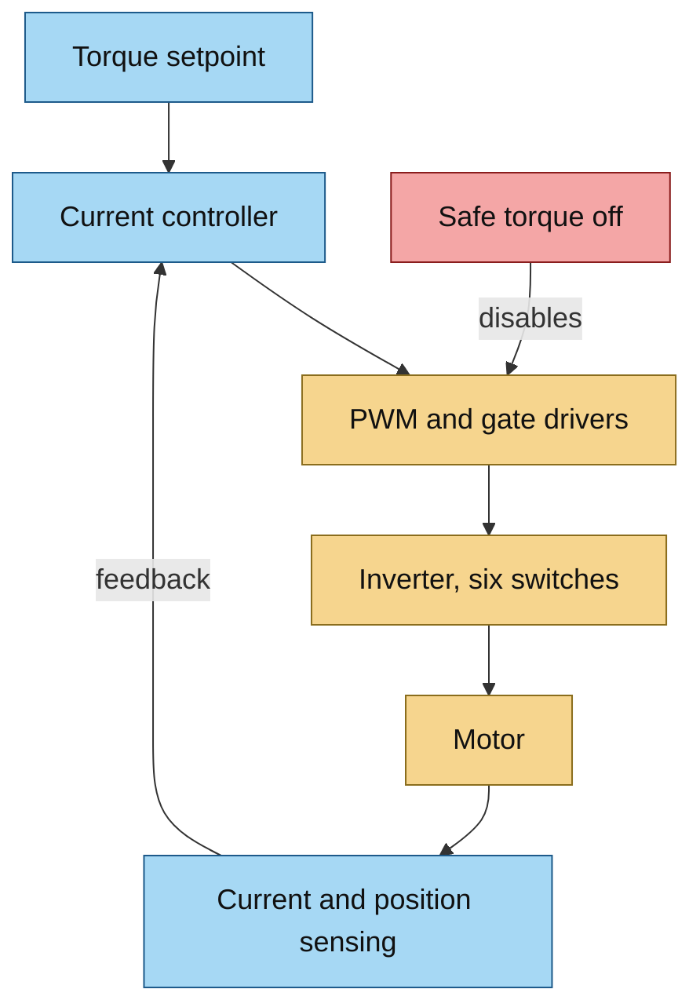

[[index|Home]]

**Scope.** This chapter covers the electronics that turn the bus's direct current into the controlled current each motor needs. Topics:

- the three-phase inverter and pulse-width modulation;
- field-oriented control;
- current and position sensing;
- switching devices;
- drive losses and heat;
- safe torque off.

The power bus that feeds the drives is in [[2.2 - Power Distribution and Protection|2.2]], motors in [[2.4 - Motors and Actuator Selection|2.4]], and joint-level control software in 3.3 (Planned). Numbers in worked examples are **illustrative estimates** unless a source sits next to them.

**Last reviewed:** 2026-11-22 (passed).

## 2.3.1 Purpose and Interfaces

A motor drive sits between the power bus and one motor. It takes a torque or current command from the controller and makes the motor produce that torque, quickly and smoothly, while protecting itself and the motor. A humanoid has one per actuated joint, so roughly as many drives as degrees of freedom.

- **Energy:** the DC bus in (about 39 to 54 V on a typical 48 V humanoid, [[2.2 - Power Distribution and Protection|2.2]] §2.2.6), three phase currents out, and heat from its own losses. Drive ratings run from tens of watts in a wrist or finger to a kilowatt or more in a hip or knee (§2.3.6 gives one supplier's figures).
- **Data:** phase-current measurements, a rotor-position measurement from an encoder, temperatures, and fault reports.
- **Commands and feedback:** a torque or current setpoint in; measured current, position, velocity and status out, usually over the robot's joint bus (2.10, Planned).
- **Timing:** the current loop runs above 10 kHz and the position loop at a few kilohertz (§2.3.6). The switches themselves turn on and off tens of thousands of times per second.
- **Physical:** a circuit board inside or near the joint, its connectors, and a path for its heat.

## 2.3.2 Fundamentals

### The three-phase inverter

A brushless motor has three windings, called phases. To make it turn, each winding needs a current that rises and falls in step with the rotor's position. The **inverter** produces those currents from the DC bus. It has three legs, one per phase. Each leg is a pair of electronic switches, one connecting the phase to the bus's positive side and one to its negative side, six switches in all.

The switches are either fully on or fully off; partly on would waste too much power. To make an in-between voltage, each leg switches back and forth very fast, and the share of time spent connected to the positive side sets the average voltage. This is **pulse-width modulation (PWM)**. The motor's winding inductance smooths the pulses into a current that follows the average. Between turning one switch of a leg off and the other on, the drive waits a short **dead time** so the two never conduct at once, which would short the bus.

Colour key: blue is control and sensing, yellow the power path, red the safety function.

### Field-oriented control, in words

The three phase currents of a motor can be described, at any instant, as one current vector rotating with the rotor. **Field-oriented control (FOC)** measures the phase currents and the rotor angle and splits that vector into two parts. One part lines up with the rotor's magnets and produces no torque. The other is at right angles to it and produces all the torque. The controller holds the first near zero, regulates the second to the commanded value, and converts the result back into the three voltages the inverter should apply.

Microchip's description of the method puts it compactly: it "takes phase currents and the rotor magnetic field vector angle of the three-phase AC motor as inputs" and "generates a commutation pattern for a three-phase voltage source inverter" ([Microchip FOC documentation](https://onlinedocs.microchip.com/oxy/GUID-69278EBA-9F00-4CEE-8103-2998236856BD-en-US-2/GUID-E191BE2C-BBD0-4208-8D15-B37ACED639DE.html)). The payoff is torque that is smooth and proportional to the torque-producing current, at any speed including standstill. That is exactly what a joint that must hold a load or press gently needs.

The main alternative is **block commutation** (also called trapezoidal control), which switches current between phases in six steps per electrical turn. Because each step lasts 60 electrical degrees, it needs only a coarse rotor angle, which three cheap Hall sensors can supply, but its torque ripples at every step. For humanoid joints, FOC is the norm in the sources found.

### Current-loop bandwidth

The current loop is the drive's innermost controller ([[1.4 - How a Humanoid Works - The Full System Map|1.4]] §1.4.3). Its **bandwidth** is how fast the measured current can follow a change in the command. Because torque follows current, the current-loop bandwidth caps how quickly the joint's torque can change. A fast current loop lets the outer controllers make a joint behave like a soft spring on contact and react to an unexpected bump within a millisecond or so. A slow one makes the joint feel stiff and late. The switching frequency limits the loop rate, since current is usually measured and updated once or twice per PWM cycle.

### Current and position sensing

The drive needs two measurements.

- **Phase current.** Usually measured by a small resistor (a **shunt**) in the current path, amplified and digitized, or by a Hall-effect current sensor. Sinusoidal control needs at least two of the three phase currents; the third follows, because the three sum to zero.
- **Rotor position.** From an **encoder**: optical, magnetic, or a resolver. A geared joint often has two, one on the motor for commutation and one on the joint output for its true angle, since gear backlash and compliance sit between them ([[2.5 - Transmissions and Joint Modules|2.5]] §2.5.1).

### Losses

A drive loses power in two ways, and both become heat in the switches:

- **Conduction loss:** current flowing through a switch that is on. A switch that is on behaves like a small resistance $R_{\text{DS(on)}}$, so the loss is $I^2 R_{\text{DS(on)}}$.
- **Switching loss:** during each turn-on and turn-off, the switch briefly carries current while voltage is still across it. The energy lost per transition is roughly proportional to bus voltage, current and transition time, so switching loss grows with switching frequency.

At the switching frequencies a fast current loop wants, switching loss in a 48 V silicon inverter can exceed conduction loss ([Bőle 2016](https://ti.com/document-viewer/lit/html/SSZTAJ4/GUID-FB9AA6C5-4129-4543-AA91-E7BC0E394470)). Smaller switches cut switching loss but raise conduction loss, so the two are traded against each other. §2.3.4 puts numbers on both for a held load.

### Safe torque off

**Safe torque off (STO)** is a safety function that removes a drive's ability to make torque, independently of the control software. It is defined in IEC 61800-5-2, the functional-safety standard for power drive systems ([IEC webstore](https://webstore.iec.ch/publication/24556)), and amounts to an uncontrolled stop, stop category 0 in IEC 60204-1 (as summarized in a [drive reference design](https://ti.com/document-viewer/lit/html/TIDUDS9B/GUID-D45B2C6F-497E-49DC-92C8-8FE46481BAA0); the standards themselves are paywalled).

The usual way to do it is to cut power to the gate drivers, the small circuits that switch the inverter's transistors on. With the gate drivers unpowered, every switch stays off and no current can be driven into the motor. Two independent channels are used, so that one failed channel cannot prevent the stop.

For a humanoid, the important consequence is physical, not electrical: a joint with no torque goes limp. On an arm that drops the load. On a standing leg it starts a fall. Stop category 0 is "uncontrolled". So STO is the last line of defence, used together with a controlled stop that first brings the robot to a safe posture ([[1.4 - How a Humanoid Works - The Full System Map|1.4]] §1.4.5, [[2.2 - Power Distribution and Protection|2.2]] §2.2.7).

## 2.3.3 Design Alternatives and Tradeoffs

### Switching devices

| Property | Silicon MOSFET | Gallium nitride (GaN) transistor |
|---|---|---|
| Switching speed | Moderate | High |
| Switching loss | Higher | Lower |
| Power density | Medium | High |
| Maturity and parts choice | Very mature, widest choice | Newer, fewer suppliers |
| Fit for a humanoid joint | The default for most drives | Where heat or size is tight, or for higher switching frequency |

GaN's lower switching loss lets a drive switch faster for a smoother current, or run cooler at the same frequency. The cost is a controller that can generate finer PWM timing, and tighter board layout to contain the faster edges. The first three rows follow a supplier comparison ([TI SLLA659](https://www.ti.com/document-viewer/lit/html/SLLA659), Table 3) from a company that sells both kinds of device; the last two are this library's summary.

**Silicon carbide (SiC)** devices are not compared here. No readable source comparing them with silicon and GaN at robot bus voltages was found.

### Drive placement

- **In the joint:** short motor cables, less electrical noise radiated through the body, and one power and communication cable through each joint ([[2.2 - Power Distribution and Protection|2.2]] §2.2.3). But the drive's heat is added to the motor's in a sealed limb, usually with no fan, and the outer surface has to stay cool enough for people to touch (§2.3.6 gives one supplier's limit; 2.8, Planned).
- **Central, in the torso:** drives share cooling and are easy to service. But three phase cables run to every motor, through every joint, carrying fast-switching edges that radiate noise toward cameras and encoders.

Placing drives in the joints is the direction the sources found describe. Thermal design (2.8, Planned) decides how much drive heat a joint can take.

### Position sensing

- **Sensored:** an encoder gives rotor angle at all speeds, including standstill. Needed for holding loads and for precise, slow motion.
- **Sensorless:** the rotor angle is estimated from the motor's voltages and currents. It saves the encoder, but estimates are poor at very low speed and standstill, which is where a humanoid joint spends much of its time.

Humanoid joints are sensored in the sources found. Sensorless control suits fans and pumps better.

## 2.3.4 Sizing or Worked Example

All values are **illustrative estimates** unless marked otherwise.

### Drive and motor loss while holding the tote at the shelf

**Inputs.**

- **Holding torque:** 34 N m at each shoulder. This is an illustrative value: half the 10 kg tote (5 kg) at 0.5 m from the shoulder, plus about 4 kg of arm acting at 0.25 m, gives $9.81 \times (5 \times 0.5 + 4 \times 0.25) = 34.3\ \text{N\,m}$, the same value [[2.4 - Motors and Actuator Selection|2.4]] §2.4.4 uses.
- **Gear ratio:** 10:1, ignoring gearbox friction (at standstill, friction can help hold), so the motor supplies 3.4 N m.
- **Motor:** torque constant $k_t = 0.2\ \text{N\,m/A}$ and phase resistance $R_{\text{ph}} = 0.1\ \Omega$.
- **Drive:** six silicon MOSFETs with $R_{\text{DS(on)}} = 5\ \text{m}\Omega$ each when hot, a 48 V bus, 40 kHz PWM, and a combined turn-on plus turn-off time of 40 ns.

**Current.** The torque-producing current is

$$
I = \frac{\tau_{\text{motor}}}{k_t} = \frac{3.4}{0.2} = 17\ \text{A}
$$

where $\tau_{\text{motor}}$ is the motor torque in N m and $I$ the amplitude of the phase current in amps.

**Conduction loss in the drive.** At any instant, each phase current flows through one switch of its leg. For three sinusoidal phase currents of amplitude $I$, the sum of the squared phase currents is $1.5\,I^2$ at every rotor angle, so

$$
P_{\text{cond}} = 1.5\, I^2 R_{\text{DS(on)}} = 1.5 \times 17^2 \times 0.005 = 2.2\ \text{W}
$$

**Switching loss in the drive.** Take the rotor angle at which one phase carries $I$ and the other two carry $I/2$ each. The three legs together then switch $2I = 34$ A. Using the rough estimate $P_{\text{sw}} \approx \tfrac{1}{2} V I_{\text{sum}}\, t_{\text{sw}}\, f_{\text{sw}}$:

$$
P_{\text{sw}} \approx 0.5 \times 48 \times 34 \times 40 \times 10^{-9} \times 40{,}000 = 1.3\ \text{W}
$$

Here $V$ is the bus voltage, $I_{\text{sum}}$ the total current switched by the three legs, $t_{\text{sw}}$ the combined transition time per cycle, and $f_{\text{sw}}$ the switching frequency. A GaN stage switching four times faster (10 ns) would cut this to about 0.3 W at the same frequency.

**Copper loss in the motor,** for comparison ([[2.4 - Motors and Actuator Selection|2.4]] §2.4.2):

$$
P_{\text{cu}} = 1.5\, I^2 R_{\text{ph}} = 1.5 \times 17^2 \times 0.1 = 43\ \text{W}
$$

| Loss while holding | Silicon drive | GaN drive (same $R_{\text{DS(on)}}$) |
|---|---|---|
| Drive conduction | 2.2 W | 2.2 W |
| Drive switching | 1.3 W | 0.3 W |
| Drive total | 3.5 W | 2.5 W |
| Motor copper | 43 W | 43 W |

**What it shows.** Holding still is not free, but almost all of the cost is in the motor windings, not the drive. With these values the drive accounts for under a tenth of the holding loss. Better switches help the drive's own temperature, which matters inside a sealed joint, but they barely change the holding energy. The levers that do are a higher torque constant, a higher gear ratio, or a posture that holds the load closer to the body ([[2.4 - Motors and Actuator Selection|2.4]] §2.4.4; 2.8, Planned).

### Tote hook

If both shoulders hold the tote at the shelf for 3 s per cycle, the energy is

$$
E = 2 \times (43 + 3.5)\ \text{W} \times 3\ \text{s} = 279\ \text{J} \approx 0.078\ \text{Wh}
$$

That is about 1.1% of the 6.95 Wh per cycle from [[2.1 - Battery Packs Battery Management and Charging|2.1]] §2.1.4, with the drives' share about 0.08%. The carry adds more holding time, at lower torque if the tote is held close. 2.8 (Planned) puts the whole holding budget together.

## 2.3.5 Validation and Failure Modes

### Tests

| Test | What it shows | Pass criterion (example) |
|---|---|---|
| Efficiency map across torque and speed | Drive loss at every operating point, including standstill | Loss within the thermal budget at the duty cycle's worst point |
| Current-loop step response | Bandwidth and overshoot of the innermost loop | Meets the bandwidth the joint controller assumes |
| Thermal test on the duty cycle | Switch and board temperature in the sealed joint | Below device ratings at maximum ambient, with margin |
| EMC test | Noise radiated and conducted by the switching | Cameras, encoders and buses run error-free; emissions within the applicable limits |
| Safe torque off verification | That each channel alone removes torque, and that diagnostics catch a failed channel | Torque removed on demand from either channel; a stuck channel is detected |
| Fault injection | Overcurrent, shorted phase, lost encoder | The drive detects each and reaches the planned state |

### Failure modes

| Failure | Cause | How it is detected | Response |
|---|---|---|---|
| Overcurrent | Stall, collision, control fault | Current sensing above a threshold | Limit current; on a hard fault disable the bridge and report |
| Failed switch (short) | Overstress, overheating | Desaturation or overcurrent detection, abnormal phase currents | Disable the bridge; the joint goes limp or is braked |
| Overheating | Sustained holding, high ambient, poor heat path | Board or switch temperature sensor | Derate torque, warn the task layer early so it can slow down |
| Encoder loss | Cable fault, sensor failure, magnet damage | Signal checks, disagreement with the output encoder | Stop commutating safely; the joint cannot be controlled without it |
| Shorted motor phase | Winding insulation failure | Phase-current imbalance | Disable the drive; a shorted motor may still produce a braking torque when turned |
| Bus undervoltage or overvoltage | Battery sag, regeneration ([[2.2 - Power Distribution and Protection\|2.2]] §2.2.2) | Bus voltage monitoring | Limit current or regeneration; disable outside the safe range |

**The legged robot's problem with "safe".** For a fixed machine, disabling the drive is safe. For a humanoid, each response above must be chosen per joint and per situation: limp, braked, or holding. A drive that disables itself on a knee fault while the robot carries a tote starts a fall. That makes fault reaction a whole-robot decision, coordinated by the safety system (5.3, Planned), not something each drive can settle alone.

## 2.3.6 Industry Progress

No humanoid maker found publishes the design of its joint drives: switching devices, switching frequency, loop rates, losses, or how safe torque off is implemented. What is published comes from a component supplier describing typical humanoid designs. It is vendor-reported, not measured on a named robot, and was accessed on 2026-11-22.

| Date | Source | Claim | Evidence stage | Link |
|---|---|---|---|---|
| 2025-01 to 2026-06 (revision span) | Texas Instruments application brief, no named platform | Drives 10 W to 4 kW, mostly 10 W to 1.5 kW; current regulation above 10 kHz and position updates at 1 to 4 kHz; at 39 V "a 4kW drive requires approximately 102 A_rms"; no fans or liquid cooling, exterior below 55 °C; "at least CAT3 PLd safety considerations need to be taken for a humanoid robot" | Supplier description of typical designs | [TI SLLA659](https://www.ti.com/document-viewer/lit/html/SLLA659) |

**What this shows.** The supplier picture is consistent with this chapter: field-oriented control, current loops above 10 kHz, drives in the joints with no fans, and a functional-safety target taken from industrial-robot standards. TI's safety statement is its own reading of those standards. Which standards apply to humanoids is still open (5.3, Planned).

## 2.3.7 Bottlenecks

- **Power density and heat.** A drive delivering up to a few kilowatts has to fit inside a slim limb, with no fan, next to a motor that is also heating up. The drive's loss is small next to the motor's (§2.3.4), but it adds to the same heat path.
- **Electrical noise.** A humanoid carries dozens of drives, each switching tens of amps tens of thousands of times a second, next to cameras, encoders and communication links. Keeping them from interfering is a system-level EMC problem ([[2.2 - Power Distribution and Protection|2.2]] §2.2.2).
- **Cost.** Every actuated joint needs its own drive, with its switches, current sensing, encoder interface and safety channel. Multiplied by the joint count, drives are a significant part of the bill of materials (6.1, Planned).
- **Safe stopping.** Safe torque off is well defined for fixed machines, where "no torque" is safe. For a biped it is not, and the drives' safety functions have to be combined with a controlled stop to a safe posture. How to certify that combination is not settled (5.3, Planned).

## 2.3.8 Implications for the Tote Transfer

- **Holding loss.** Holding the tote at the shelf for 3 s costs about 1% of the cycle's energy in this example, almost all of it in the motor windings, not the drive (§2.3.4). Holding the tote closer to the body during the carry cuts it further.
- **Placing.** A gentle, compliant placement onto a shelf or conveyor depends on the current loop. The faster the drive can change torque, the more softly the outer controllers can make the arm yield when the tote touches down (3.3, 3.8, Planned).
- **Faults mid-carry.** An arm drive that trips while holding the tote drops it. The fault response should hold, brake or lower where possible, and the task layer must be told at once (4.3, Planned).
- **Simpler alternative.** A conveyor uses a few motors running at steady speed, with drives in a cabinet and no need to hold loads still or yield on contact. Its drives are simple, cheap and easy to make safe by cutting power.

## Related Notes

- [[index|Home]]
- Previous: [[2.2 - Power Distribution and Protection|2.2 Power Distribution and Protection]]
- [[1.4 - How a Humanoid Works - The Full System Map|1.4]] §1.4.3 (control layers and rates), §1.4.5 (safe stopping)
- [[Glossary]] · [[Source Index]]
- Next: [[2.4 - Motors and Actuator Selection|2.4 Motors and Actuator Selection]]
- Deeper treatment: 2.8 Thermal Management and Energy Budgets, 3.3 Joint-Level Control and Actuator Characterization, 5.3 Safety Architecture, Risk Assessment, and Compliance (all Planned)

## Sources

- Texas Instruments (2025, revised 2026). *Motor Control in Humanoid Robots*, application brief SLLA659A. https://www.ti.com/document-viewer/lit/html/SLLA659 ([[Source Note - TI SLLA659 Motor Control in Humanoid Robots]])
- Microchip Technology (undated). *Sensorless Field Oriented Control for a Permanent Magnet Synchronous Motor Using Sliding Mode Observer*, section 2 "Field Oriented Control". https://onlinedocs.microchip.com/oxy/GUID-69278EBA-9F00-4CEE-8103-2998236856BD-en-US-2/GUID-E191BE2C-BBD0-4208-8D15-B37ACED639DE.html ([[Source Note - Microchip Field Oriented Control Documentation]])
- Bőle, Z. P. (2016). *Gallium Nitride Transistors Open up New Frontiers in High-speed Motor Drives*. Texas Instruments, SSZTAJ4. https://ti.com/document-viewer/lit/html/SSZTAJ4/GUID-FB9AA6C5-4129-4543-AA91-E7BC0E394470 ([[Source Note - Bole 2016 TI GaN in High-Speed Motor Drives]])
- Texas Instruments (2017, revised 2022). Safe torque off reference design guide TIDUDS9B (TIDA-01599), used for its summary of the STO definition. https://ti.com/document-viewer/lit/html/TIDUDS9B/GUID-D45B2C6F-497E-49DC-92C8-8FE46481BAA0 ([[Source Note - TI TIDUDS9B Safe Torque Off Reference Design]])
- IEC (2016). IEC 61800-5-2:2016, *Adjustable speed electrical power drive systems, Part 5-2: Safety requirements, Functional*. https://webstore.iec.ch/publication/24556 ([[Source Note - IEC 61800-5-2 2016]])
