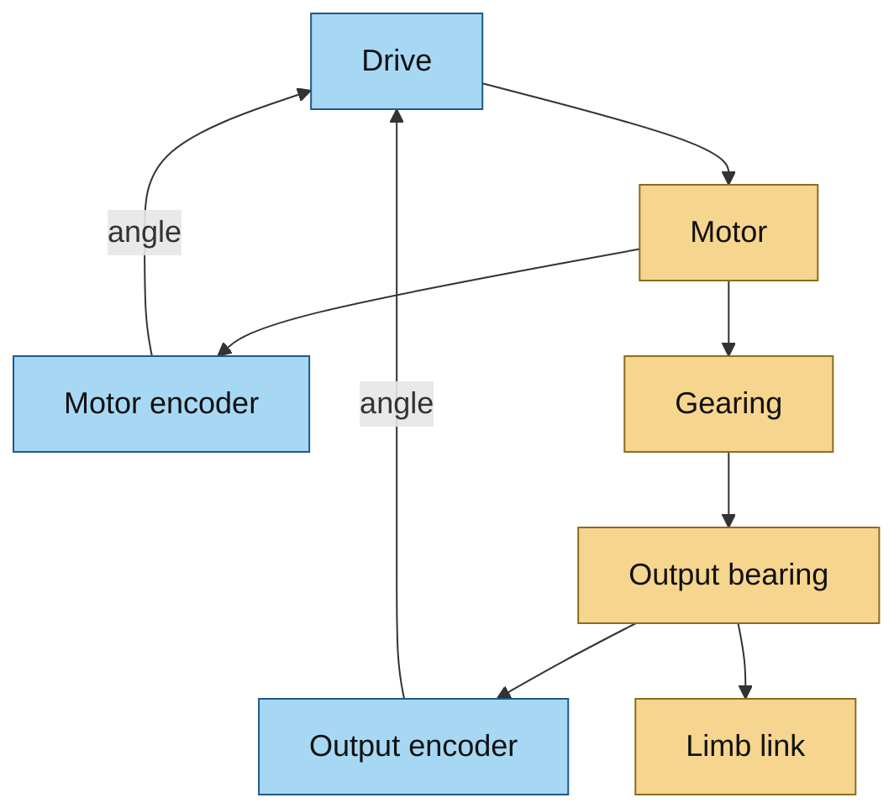

[[index|Home]]

**Scope.** This chapter covers how motor speed is traded for joint torque, and how the motor, drive, gearing, sensors and bearings come together in a joint module. Topics:

- gear ratio and its side effects: reflected inertia, friction, backlash and stiffness;
- the main transmission types and how to choose one per joint;
- joint-module integration.

Motors are in [[2.4 - Motors and Actuator Selection|2.4]], drives in [[2.3 - Motor Drives and Power Electronics|2.3]], and the structure around the joints in [[2.6 - Mechanical Architecture and Structures|2.6]]. Numbers in worked examples are **illustrative estimates** unless a source sits next to them.

## 2.5.1 Purpose and Interfaces

A brushless motor is good at spinning fast with modest torque. A humanoid joint needs the opposite: high torque at low speed. The transmission makes that trade, and its side effects shape how the joint feels to touch, how well it can be controlled, and how long it lasts.

- **Energy:** motor torque and speed in, joint torque and speed out, and friction losses as heat in the gearing and bearings.
- **Data:** a motor-side encoder for commutation, an output-side encoder for the true joint angle, and on some joints a torque sensor at the output.
- **Commands and feedback:** these pass through the drive ([[2.3 - Motor Drives and Power Electronics|2.3]] §2.3.1). The transmission has no electronics of its own, but its friction, free play and stiffness sit inside every control loop around it.
- **Timing:** free play delays the moment the output responds when torque reverses, and elasticity delays and rings the response to a step.
- **Physical:** the output bearing carries the limb's loads, including bending loads from the link. Seals keep lubricant in and dust out. Mass and diameter decide whether the module fits in the limb.

Colour key: blue is electronics and sensing, yellow the mechanical path from motor to limb. Everything above the limb link is one joint module.

## 2.5.2 Fundamentals

### Gear ratio

A transmission with ratio $N$ multiplies torque by $N$ and divides speed by $N$, less its losses:

$$
\tau_{\text{joint}} = \eta\, N\, \tau_{\text{motor}}, \qquad \omega_{\text{joint}} = \frac{\omega_{\text{motor}}}{N}
$$

Here $\tau$ is torque in N m, $\omega$ speed in rad/s, and $\eta$ the transmission's efficiency (between 0 and 1) when the motor drives the load. A higher ratio lets a smaller, lighter motor produce the same joint torque, with less current and so less copper heat ([[2.4 - Motors and Actuator Selection|2.4]] §2.4.2). The costs are the side effects below.

### Reflected inertia

The motor's rotor spins $N$ times faster than the joint. Its kinetic energy is $\tfrac{1}{2} J_{\text{rotor}} \omega_{\text{motor}}^2 = \tfrac{1}{2} J_{\text{rotor}} N^2 \omega_{\text{joint}}^2$, so seen from the joint, the rotor behaves like an inertia of

$$
J_{\text{reflected}} = N^2 J_{\text{rotor}}
$$

where $J_{\text{rotor}}$ is the rotor's moment of inertia in kg m². The square is what matters. Going from 10:1 to 100:1 makes the same rotor feel a hundred times heavier at the joint. When the limb hits something, that inertia has to be stopped too, through the gear teeth. High-ratio joints therefore hit harder and are harder to push back by hand. This is the quantity that the impact mitigation factor of Seok, Wensing et al. was built to capture ([Seok, Wensing et al., 2017](https://dspace.mit.edu/handle/1721.1/119863)).

### Losses, backlash and stiffness

- **Efficiency.** Friction between teeth, in bearings and in the lubricant turns some of the motor's work into heat. Efficiency usually falls at light loads and low temperatures, when lubricant drag is a large share of the torque, and it differs between driving forward and being driven backward.
- **Backlash.** Free play between teeth. When torque reverses, the output does not move until the play is taken up. That costs precision and can make a position controller hunt back and forth around its target.
- **Stiffness.** How much the transmission twists under load. A soft transmission lets the output lag the motor and ring after a fast move, which limits how fast the outer control loops can be.
- **Friction and stiction.** Friction that must be overcome before motion starts hides small forces from the motor-current measurement, so the joint cannot feel light contacts.

### Backdrivability

A joint is **backdrivable** if an external force at the output can turn the motor back through the gearing ([[2.4 - Motors and Actuator Selection|2.4]] §2.4.3). Two things set it: the friction in the gearing, and the reflected inertia. A low-ratio, low-friction joint can be pushed by hand and can sense the push through its motor current. A high-ratio joint may not move at all until the force is large. Some gearing, such as some screws and worm gears, is non-backdrivable by design, which lets a joint hold a load with no current at all but also means it cannot yield.

### Joint modules

A **joint module** packages the motor, drive, gearing, both encoders, the output bearing and the seals into one unit with a single power and communication connection ([[2.2 - Power Distribution and Protection|2.2]] §2.2.3). Integration matters for three reasons:

- **Size and mass:** sharing one housing and one bearing set saves both, in a limb where every gram costs energy.
- **Testing:** a module can be characterized on a bench before it goes into a robot, and swapped when it fails.
- **Cost:** a robot with a few module sizes used across many joints buys in volume, which matters when there are dozens of joints (6.1, Planned).

The cost of integration is heat: the motor, drive and gearing all lose energy inside one sealed housing ([[2.8 - Thermal Management and Energy Budgets|2.8]]).

## 2.5.3 Design Alternatives and Tradeoffs

### Transmission types

| Type                   | How it works                                                                                  | Ratio per stage                                   | Backlash and stiffness                                   | Backdrivability and impact                                      | Typical use                                                     |
| ---------------------- | --------------------------------------------------------------------------------------------- | ------------------------------------------------- | -------------------------------------------------------- | --------------------------------------------------------------- | --------------------------------------------------------------- |
| Planetary              | A central sun gear drives planet gears that roll inside a ring gear                           | Low to moderate; stages multiply                  | Some backlash; stiff                                     | Backdrivable at low ratio; teeth take impacts well              | Quasi-direct-drive legs and arms                                |
| Cycloidal              | An eccentric disc with lobes rolls inside a ring of pins                                      | Moderate to high in one stage                     | Low backlash; stiff, many lobes share the load           | Good shock tolerance; backdrivable at low ratio                 | Legs and arms; Zhu et al. use 10:1                              |
| Harmonic (strain-wave) | A flexible toothed cup is squeezed into an oval and meshes with a rigid ring                  | High in one stage                                 | Near-zero backlash, but the flexible cup makes it softer | Poorly backdrivable; the flexible cup is less tolerant of shock | Compact, precise joints such as wrists and arms                 |
| Ball or roller screw   | A nut on a threaded shaft turns rotation into linear motion, through rolling balls or rollers | Set by the thread pitch and the linkage lever arm | Low backlash when preloaded; stiff                       | Ball screws can be backdriven; high force in a slim package     | Knees and ankles through linkages                               |
| Belt or cable          | A toothed belt or cable runs between pulleys                                                  | Low                                               | Stretch adds compliance                                  | Backdrivable                                                    | Moving a motor away from a joint, often combined with a gearbox |

Low ratios can still be precise: a 10:1 cycloidal stage built for legged robots measured about 7 arcmin of backlash ([Zhu et al., 2025](https://arxiv.org/abs/2410.16591)). A screw and linkage can also do something no gearbox does, letting the ratio fall as a humanoid knee extends ([Ma et al., 2025](https://arxiv.org/abs/2506.12314)).

**Planetary against harmonic.** Nandor et al. built two actuators with the same motor, brake and size (2.1 kg each), one with a 50:1 harmonic drive and one with a 47.3:1 two-stage planetary gearbox, and tested them on the bench ([Nandor et al., 2021](https://doi.org/10.3390/act10090203)). The planetary actuator gave 3.39 N m per amp against 2.07, its passive resistance peaked at 4 N m against 6.5 N m, and its mechanical efficiency was about double. The harmonic actuator also could not reach the target speed: vibration at its input stopped the test at 270 deg/s. The application was an exoskeleton joint, and it is one pair of builds, but it supports the table: where a joint must be backdrivable and efficient, a planetary gearbox beats a harmonic drive of similar ratio.

### Choosing per joint

Joints differ in their loads, speeds, duty cycles and how often they hit things, so one robot often mixes transmissions ([[2.4 - Motors and Actuator Selection|2.4]] §2.4.3).

- **Hips and knees:** high torque and an impact at every step. Low-ratio planetary or cycloidal gearing keeps the joint backdrivable and shock-tolerant. A screw and linkage can deliver high force and change its effective ratio over the stroke.
- **Shoulders and elbows:** long holds and occasional bumps. A moderate ratio, about 20:1 to 30:1, through a planetary or cycloidal gearbox, cuts holding heat several times over while keeping the arm backdrivable (§2.5.4).
- **Wrists:** low torque in tight space, where precision matters. Harmonic drives fit, at the cost of shock tolerance.
- **Ankles:** high torque at the far end of the leg, where mass is expensive to swing. A motor placed higher up driving the ankle through a linkage, a screw or a belt keeps the mass near the knee.

## 2.5.4 Sizing or Worked Example

All values are **illustrative estimates** unless marked otherwise.

### Hitting the shelf: impact force against gear ratio

**Situation.** The robot's empty hand, moving at 0.5 m/s, bumps the edge of a steel shelf. The shoulder is the only moving joint.

**Inputs.**

- **Arm:** 4 kg and 0.5 m long, as in [[2.4 - Motors and Actuator Selection|2.4]] §2.4.4. Treated as a uniform rod, its inertia about the shoulder is $\tfrac{1}{3} \times 4 \times 0.5^2 = 0.333\ \text{kg\,m}^2$. At the hand that feels like $0.333 / 0.5^2 = 1.33\ \text{kg}$.
- **Rotor:** inertia $1 \times 10^{-4}\ \text{kg\,m}^2$, the same motor at every ratio.
- **Contact:** a stiffness of 50,000 N/m between hand and shelf, standing for a thin rubber pad on the hand.
- **Ratios:** 6:1, 50:1 and 100:1.

**Effective mass at the hand.** The rotor's reflected inertia, moved out to the hand at radius $r$, adds a mass

$$
m_{\text{reflected}} = \frac{N^2 J_{\text{rotor}}}{r^2}
$$

so the hand feels $m_{\text{eff}} = 1.33\ \text{kg} + m_{\text{reflected}}$.

**Peak force.** Before any controller reacts, the impact behaves like a mass hitting a spring. The peak force and the time to reach it are

$$
F_{\text{peak}} = v \sqrt{k\, m_{\text{eff}}}, \qquad t_{\text{peak}} = \frac{\pi}{2} \sqrt{\frac{m_{\text{eff}}}{k}}
$$

where $v$ is the hand's speed in m/s and $k$ the contact stiffness in N/m. Part of that force is spent stopping the rotor, and that part passes through the gear teeth. Its share is $m_{\text{reflected}} / m_{\text{eff}}$, and times the 0.5 m arm it gives the torque that the teeth carry.

| Ratio | Reflected mass at hand | Effective mass | Peak force | Time to peak | Torque through the gear teeth |
|---|---|---|---|---|---|
| 6:1 | 0.014 kg | 1.35 kg | 130 N | 8.2 ms | 0.7 N m |
| 50:1 | 1.0 kg | 2.33 kg | 171 N | 10.7 ms | 37 N m |
| 100:1 | 4.0 kg | 5.33 kg | 258 N | 16.2 ms | 97 N m |

**What it shows.**

- **The arm's own mass sets a floor.** At 6:1 the rotor is almost invisible and the hand hits with the arm's mass alone. A lower ratio needs a bigger motor, but even a rotor with five times the inertia raises the 6:1 peak only from 130 N to 133 N.
- **The rotor dominates at high ratio.** At 100:1 the rotor feels three times heavier than the arm, and the peak force doubles.
- **The gear teeth take the hit.** At 100:1 the teeth carry about 97 N m in a bump, nearly three times the 34.3 N m of holding the tote at the shelf ([[2.4 - Motors and Actuator Selection|2.4]] §2.4.4), with no command from the controller. At 6:1 they carry under 1 N m. That is why high-ratio joints need a torque limiter, a spring, or a larger gearbox to survive bumps and falls.
- **Control can help, but late.** The force peaks in about 8 to 16 ms. A backdrivable joint senses the contact through its motor current and can start yielding within that time. A high-ratio joint with high friction may barely move, so the outer controller sees the contact late, if at all.

The model ignores friction, gear elasticity and the controller, so it gives the passive case. A soft transmission or a series spring lowers the peak, at the cost of position precision.

### Gearbox efficiency and holding heat

Efficiency changes how much motor torque a joint needs. While lifting, the motor must supply $\tau_{\text{joint}} / (\eta N)$. Copper loss goes with torque squared ([[2.4 - Motors and Actuator Selection|2.4]] §2.4.2), so at $\eta = 0.9$ the motor's heat rises by $1/0.9^2 = 1.23$, or 23%. The shoulder's lift loss in 2.4 would rise from 98 W to about 121 W. Measured gearbox efficiencies near 90% are reported for printed cycloidal gearboxes ([Chi et al., 2025](https://arxiv.org/abs/2504.17249)). While holding still, friction can work either way: it can help hold a load, or add to the torque needed if the joint must keep correcting.

### Choosing a shoulder and elbow ratio

The two calculations pull in opposite directions. Holding heat falls with the square of the ratio, since the same motor needs proportionally less current. Bump force and gear-tooth load rise with it. Using the same motor and arm as above, and the 43 W of holding at the shelf at 10:1 from [[2.4 - Motors and Actuator Selection|2.4]] §2.4.4:

| Ratio | Copper loss holding at the shelf | Peak bump force | Torque through the gear teeth | Motor speed in the lift |
|---|---|---|---|---|
| 10:1 | 43 W | 131 N | 1.9 N m | 8 rad/s |
| 20:1 | 10.8 W | 137 N | 7.3 N m | 16 rad/s |
| 30:1 | 4.8 W | 146 N | 15.5 N m | 24 rad/s |
| 50:1 | 1.7 W | 171 N | 37 N m | 40 rad/s |

**Recommendation for the shoulder.** A planetary or cycloidal gearbox at about 20:1 to 30:1. Against 10:1 it cuts holding heat by four to nine times, raises the bump force by only 4% to 11%, and keeps the tooth load in a bump below half the 34.3 N m holding torque. Beyond about 30:1 the holding gain is small and the bump cost grows fast: at 50:1 the teeth carry more in a bump than they do holding the tote. A harmonic drive is not recommended here, for the backdrivability and efficiency reasons above. The holding figures assume the same motor and ignore gearbox losses, which are larger in a two-stage gearbox, so the real gain is somewhat smaller.

**Elbow.** Holding the tote's half at 0.25 m from the elbow, with a 1.5 kg forearm acting at 0.125 m, needs $9.81 \times (5 \times 0.25 + 1.5 \times 0.125) = 14.1\ \text{N\,m}$, about 40% of the shoulder's torque. The same reasoning applies, so the same gearbox type and ratio range in a smaller module suits it.

### Tote hook

When the robot places the tote, half the tote's 10 kg adds 5 kg to each hand, so the ratio's share shrinks. At a 0.1 m/s touchdown with the same contact stiffness, the peak force per hand is about 56 N at 6:1, 61 N at 50:1 and 72 N at 100:1, against a static load of $5 \times 9.81 = 49\ \text{N}$. So the gentleness of a planned placement depends mostly on the touchdown speed and the controller. The ratio matters most for unplanned bumps with an empty or outstretched hand, when the arm is light and the rotor is a large share of what hits.

## 2.5.5 Validation and Failure Modes

### Tests

| Test | What it shows | Pass criterion (example) |
|---|---|---|
| Backlash | Free play at the output with the motor held | Within the joint's precision budget at the start of life and after wear testing |
| Torsional stiffness | Twist of the output under a known torque | High enough for the joint's control bandwidth |
| Efficiency map | Forward and backward efficiency across torque, speed and temperature | Matches the energy model ([[2.4 - Motors and Actuator Selection\|2.4]] §2.4.4) at the duty cycle's operating points |
| Backdrive torque | Torque needed to turn the joint from the output | Low enough for the compliance the joint needs |
| Life test | Wear on a representative duty cycle | Backlash and efficiency within limits after the target number of cycles |
| Impact test | Damage and peak torque when the output is struck or the robot falls | No tooth, bearing or housing damage at the specified impact |

An example of measured wear comes from Berkeley Humanoid Lite. Chi et al. ran one actuator for 60 hours, swinging a 0.5 kg mass on a 0.5 m arm from −45° to +90° at 0.5 Hz. Efficiency "initially declined but later returned to near its original level", and backlash "increased slightly" as the printed parts wore ([Chi et al., 2025](https://arxiv.org/abs/2504.17249)). It is a component bench test, not field life.

### Failure modes

| Failure | Cause | How it is detected | Response |
|---|---|---|---|
| Tooth wear and growing backlash | Load cycles, poor lubrication, contamination | Disagreement between motor and output encoders; worse position tracking | Service item; trend the backlash in diagnostics |
| Tooth or flexible-cup fracture | Impact, fall, overload | Sudden loss of output motion with the motor turning | Stop the joint; replace the module |
| Bearing failure | Bending loads, impacts, wear | Rising friction, noise, vibration | Service item; trend friction |
| Lubricant loss or breakdown | Failed seal, heat | Rising friction and temperature | Service; check seals and temperatures |
| Screw jam | Debris, damaged balls or rollers | Motor current rising with no motion | Stop the joint; the linkage may lock the limb in place |

Falls are the hardest load case. A falling humanoid strikes the ground through whatever joints hit first, and the reflected inertia of every high-ratio joint adds to the shock its teeth must carry (§2.5.4). Durability testing for falls belongs in 5.4 (Planned).

## 2.5.6 Industry Progress

No commercial humanoid maker found publishes its transmission types, ratios or test data. What is published comes from research groups, author-measured on their own hardware.

| Date | Platform | Claim | Evidence stage | Source |
|---|---|---|---|---|
| 2021-08-25 | Exoskeleton actuators, same motor, 50:1 harmonic against 47.3:1 two-stage planetary | Planetary: 3.39 against 2.07 N m/A, peak passive resistance 4 against 6.5 N m, about double the mechanical efficiency | Research prototype, bench-tested | [Nandor et al., 2021](https://doi.org/10.3390/act10090203) |
| 2025-03-20 (v2) | UCLA cycloidal quasi-direct-drive actuator | 10:1 cycloidal gearbox; backlash about 7.0 arcmin; efficiency 82.3%; static back-drive torque 1.99 N m | Research prototype, bench-tested | [Zhu et al., 2025](https://arxiv.org/abs/2410.16591) |
| 2025 | Berkeley Humanoid Lite | 3D-printed cycloidal gearboxes; mechanical efficiency about 90% over most conditions; 60 h wear test with backlash increasing slightly | Research robot, open source | [Chi et al., 2025](https://arxiv.org/abs/2504.17249) |
| 2025-06-14 | Humanoid knee | Linear actuator and linkage with a "dynamically decreasing reduction ratio" | Research prototype on a humanoid | [Ma et al., 2025](https://arxiv.org/abs/2506.12314) |

**What this shows.** Research actuators for legged robots lean toward low-ratio planetary and cycloidal gearing, which keeps joints backdrivable and shock-tolerant. None of these reports gives wear data over a product life, or fall-impact data on a working humanoid.

## 2.5.7 Bottlenecks

- **Cost and supply of precision gearing.** Harmonic drives and roller screws are precision parts, made by few suppliers. A humanoid needs many of them. Whether low-cost gearing can match their precision and life at volume is not shown by any source found (5.6, 6.1, Planned).
- **Surviving falls.** A transmission sized for normal work may fail in the first fall. Making every joint survive falls adds mass, while torque limiters and springs add parts (5.4, Planned).
- **Wear over a product life.** Backlash grows and efficiency changes as gearing wears. A robot that needs fine precision at the start of its life must keep it after years of cycles, or be recalibrated and serviced (5.7, 5.8, Planned).
- **Heat in a sealed module.** Gearbox losses add to the motor's and the drive's in one housing with no fan, and grease degrades with heat ([[2.8 - Thermal Management and Energy Budgets|2.8]]).

## 2.5.8 Implications for the Tote Transfer Example

- **Gentle placement.** A planned placement of the 10 kg tote is gentle mainly through low touchdown speed and good control. The tote's mass dominates what the hand feels, so the ratio matters less (§2.5.4).
- **Bumps.** An unplanned bump with an empty or outstretched hand is where ratio matters. At 100:1 the hand hits twice as hard as at 6:1, and the gear teeth carry nearly three times the shelf-holding torque.
- **Shoulder and elbow gearing.** A planetary or cycloidal gearbox at about 20:1 to 30:1 cuts the shelf-holding loss from 43 W to between 4.8 and 10.8 W per shoulder, against 10:1, for a small rise in bump force (§2.5.4).
- **Holding efficiency.** A 90% efficient gearbox raises the motor's lifting heat by about 23%. The thermal budget must include it ([[2.4 - Motors and Actuator Selection|2.4]] §2.4.4; [[2.8 - Thermal Management and Energy Budgets|2.8]]).
- **Simpler alternative.** A conveyor or a fixed arm never needs to be pushed back by a person or survive a fall, so it can use stiff, high-ratio gearing that is cheap and precise.

## Related Notes

- [[index|Home]]
- Previous: [[2.4 - Motors and Actuator Selection|2.4 Motors and Actuator Selection]]
- [[2.3 - Motor Drives and Power Electronics|2.3]] §2.3.2 (encoders and the current loop)
- [[Glossary]] · [[Source Index]]
- Next: [[2.6 - Mechanical Architecture and Structures|2.6 Mechanical Architecture and Structures]]
- Deeper treatment: [[2.8 - Thermal Management and Energy Budgets|2.8 Thermal Management and Energy Budgets]]; 3.3 Joint-Level Control and Actuator Characterization, 5.4 Reliability, Durability, and Environmental Testing (both Planned)

## Sources

- Nandor, M. J., Heebner, M., Quinn, R., Triolo, R. J. and Makowski, N. S. (2021). Transmission Comparison for Cooperative Robotic Applications. *Actuators* 10(9), 203. https://doi.org/10.3390/act10090203 ([[Source Note - Nandor 2021 Transmission Comparison for Cooperative Robotic Applications]])
- Seok, S., Wensing, P. M., Wang, A., Otten, D., Lang, J. and Kim, S. (2017). Proprioceptive Actuator Design in the MIT Cheetah: Impact Mitigation and High-Bandwidth Physical Interaction for Dynamic Legged Robots. *IEEE Transactions on Robotics* 33(3), 509 to 522. https://dspace.mit.edu/handle/1721.1/119863 ([[Source Note - Seok and Wensing 2017 Proprioceptive Actuator Design]])
- Zhu, A., Tanaka, Y., Rafeedi, F. and Hong, D. (2025). Cycloidal Quasi-Direct Drive Actuator Designs with Learning-based Torque Estimation for Legged Robotics. arXiv:2410.16591. https://arxiv.org/abs/2410.16591 ([[Source Note - Zhu 2025 Cycloidal Quasi-Direct Drive Actuator]])
- Chi, Y. et al. (2025). Demonstrating Berkeley Humanoid Lite. *Robotics: Science and Systems XXI*. https://arxiv.org/abs/2504.17249 ([[Source Note - Chi 2025 Berkeley Humanoid Lite]])
- Ma, X. et al. (2025). Explosive Output to Enhance Jumping Ability: A Variable Reduction Ratio Design Paradigm for Humanoid Robots Knee Joint. arXiv:2506.12314. https://arxiv.org/abs/2506.12314 ([[Source Note - Ma 2025 Humanoid Knee Variable Reduction Ratio]])
