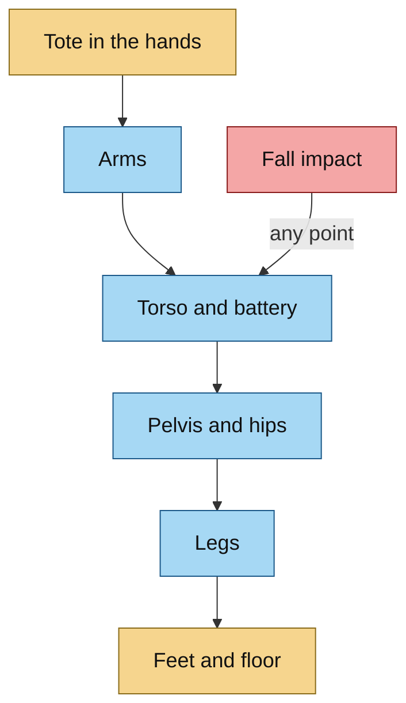

[[index|Home]]

**Scope.** This chapter covers the robot's body as a structure. Topics:

- where the joints go and how mass is distributed;
- link materials, and stiffness against mass;
- bearings, cable routing, covers and sealing;
- surviving falls, and service access.

Joint modules are in [[2.5 - Transmissions and Joint Modules|2.5]] and hands in [[2.7 - Hands Grippers and End Effectors|2.7]]. Numbers in worked examples are **illustrative estimates** unless a source sits next to them.

## 2.6.1 Purpose and Interfaces

The structure holds every other subsystem in place and carries the loads between them: the tote's weight from the hands to the feet, the shock of every footstep, and, now and then, the whole robot hitting the floor. It must do that while staying light, because every kilogram in a limb costs energy to move and torque to hold ([[2.4 - Motors and Actuator Selection|2.4]] §2.4.2).

- **Physical:** loads from the payload, from walking and from falls; mounting points for the joint modules, battery, compute and sensors.
- **Energy:** the structure carries no power itself, but it routes the power and data harness ([[2.2 - Power Distribution and Protection|2.2]] §2.2.3) and provides the paths that carry heat out of the joints ([[2.8 - Thermal Management and Energy Budgets|2.8]]).
- **Data:** camera, lidar and inertial sensor mounts that must hold their calibration through vibration and knocks ([[2.9 - Sensors Calibration and Time Synchronization|2.9]]).
- **Environment:** weather, moisture, temperature, and contact with people and equipment.

Colour key: yellow is where the working load enters and leaves, blue the structure that carries it, red a fall, which can strike anywhere.

## 2.6.2 Fundamentals

### Kinematic layout

The layout fixes where the joints sit, in what order, and how far each can turn ([[1.2 - What Is a Humanoid Robot|1.2]] §1.2.2). It decides the robot's reach, the postures it can hold, and how far each joint is from the loads it carries. A humanoid copies the human layout because its workplaces were built for people, but it need not copy human joint limits. A joint that can turn further than a person's can reach behind the robot or recover from a fall in ways a person cannot.

### Mass distribution

Where the mass sits matters as much as how much there is. Mass far out on a limb raises the limb's inertia with the square of its distance from the joint, so it costs torque to accelerate and energy to swing at every step. Designers therefore keep heavy parts, such as the battery, the compute and the larger motors, in the torso and near the hips, and drive distant joints such as the ankles through linkages from motors mounted higher up ([[2.5 - Transmissions and Joint Modules|2.5]] §2.5.3). A light foot and lower leg also make each step's impact smaller.

### Stiffness against mass

A link bends under load. If the controller does not know how much, the hand ends up somewhere other than where the robot thinks it is. Stiffness depends on two things: the material's **Young's modulus** $E$, its resistance to stretching, and the shape of the section, through its **second moment of area** $I$. For a link held at one end with a load at the other, the tip deflection is

$$
\delta = \frac{F L^3}{3 E I}
$$

where $\delta$ is the deflection in m, $F$ the load in N, $L$ the link length in m, $E$ in Pa and $I$ in m⁴. Two things follow. Length matters most, since deflection grows with its cube. And shape matters as much as material: a hollow tube or a box section puts material far from the centre, where it adds most to $I$, which is why robot links are hollow.

### Materials

The common metals all have nearly the same stiffness per unit mass:

| Material         | Young's modulus | Density             | Stiffness per mass |
| ---------------- | --------------- | ------------------- | ------------------ |
| Structural steel | 200 GPa         | 7.82 t/m³           | 25.6 MN m/kg       |
| Aluminum alloys  | 70 GPa          | 2.6 to 2.85 t/m³    | about 25.9 MN m/kg |
| Magnesium        | 45 GPa          | 1.74 t/m³           | 25.9 MN m/kg       |
| Titanium alloy   | 105 to 120 GPa  | 4.5 t/m³ (titanium) | 23 to 27 MN m/kg   |
| Nylon 6          | 2 to 4 GPa      | 1.12 to 1.17 t/m³   | 1.7 to 3.6 MN m/kg |
| ABS plastic      | 1.4 to 3.1 GPa  | 1.06 t/m³           | 1.3 to 2.9 MN m/kg |

Modulus and density are from Engineering ToolBox's tables ([Young's modulus](https://www.engineeringtoolbox.com/young-modulus-d_417.html); [densities](https://www.engineeringtoolbox.com/density-solids-d_1265.html)); the last column is their ratio. Carbon-fibre-reinforced plastic is listed at 150 GPa, but only along the fibres; across them it is far less, so its stiffness depends on how the layers are laid up.

What this means for design:

- **Among metals, the choice is not about stiffness per mass.** It is about strength, fatigue, cost, and how the part is made. Aluminum is the usual default because it machines and casts easily.
- **Lighter metals still help in bending.** At equal mass, a magnesium link can be thicker than an aluminum one, and a thicker section is stiffer in bending, since $I$ grows quickly with size.
- **Unreinforced plastics are about ten times less stiff per mass.** That suits covers and low-load parts, and 3D-printed structures in small, light robots, but not long links carrying a payload (§2.6.4).

### Bearings

The joint bearings carry the limb's loads, not only its torque. A shoulder holding the tote at reach carries the tote's weight as a shear force and a bending moment as well as the joint torque. Joint modules therefore use bearings that can take loads in several directions at once, such as crossed-roller bearings at the output ([[2.5 - Transmissions and Joint Modules|2.5]] §2.5.1). Undersized bearings show up as play in the limb, and later as wear.

### Cable routing

Every joint has power and data cables crossing it. They can run outside the joint in a slack loop, through a hollow shaft, or across a slip ring for joints that turn without limit ([[2.2 - Power Distribution and Protection|2.2]] §2.2.3). Cables bent at every step fatigue, so routing is a structural design problem as much as an electrical one.

### Sealing and IP codes

Dust and water kill electronics and wash grease out of gearboxes. An enclosure's protection is graded by the **IP code** of IEC 60529. Its first numeral grades protection against solids, from 0 (none) to 6 (no ingress of dust). Its second grades protection against liquids, from 0 to 9 ([IEC](https://www.iec.ch/ip-ratings)). Sealing a moving robot is harder than sealing a box. Every joint has a rotating shaft to seal, covers must flex or slide, and the seals add friction, which hides small forces from the motor current ([[2.5 - Transmissions and Joint Modules|2.5]] §2.5.2).

## 2.6.3 Design Alternatives and Tradeoffs

### Frame layout

- **Internal frame with covers:** a skeleton of links and joint modules carries the loads, and light covers protect it. Easy to design, analyze and service; covers can be swapped after damage. The frame and the covers each add mass.
- **Load-carrying shell:** the outer skin is the structure, as in a car body or an aircraft fuselage. A shell places material at the largest possible radius, so it is stiff and light for its size. But a dent in the skin damages the structure, and getting inside to service it is harder.

Many robots mix the two, with a shell torso and framed limbs.

### Materials and processes

The table in §2.6.2 sets the trade. Machined aluminum suits prototypes and low volumes. Castings and molded parts suit volume, but need tooling (5.6, Planned). Printed plastics make cheap, fast prototypes and can carry real loads in a small robot: Berkeley Humanoid Lite is a 16 kg, 0.8 m humanoid built largely from 3D-printed parts ([Chi et al., 2025](https://arxiv.org/abs/2504.17249)). At full human size, with longer links and heavier payloads, the cube of the length in §2.6.2 works against plastics.

### Surviving falls

A biped will fall. Three approaches, often combined:

- **Make the structure strong enough.** Simple, but it adds mass everywhere, which costs energy on every step.
- **Pad the robot.** Soft layers spread and slow the impact. Wang et al. fitted a 42 kg humanoid with a padding material that "rapidly stiffens under impact". In a drop test of a 5 kg mass from 1 m, following a European certification protocol, a 6 mm layer cut the peak force by 70%, from 86.8 kN to 25.8 kN, and a 12 mm layer by 87.1%. On the robot it allowed repeated falls, including drops from 3 m, without hardware damage. Ordinary rubber or silicone needed about twice the thickness for the same effect ([Wang et al., 2026](https://arxiv.org/abs/2601.02857)).
- **Fall well.** A controller that sees an unavoidable fall coming can turn the robot to land on its strongest parts. On a Unitree G1, Meng et al. report that their learned protective controller cut peak contact forces by 68.3% and peak joint torques by 78.4% against unprotected falls, and avoided 99.3% of impacts on vulnerable parts such as the head and hands ([Meng et al., 2025](https://arxiv.org/abs/2511.18509)). Fall control belongs with balance in 3.7 (Planned).

Sacrificial parts, such as cheap covers or bumpers meant to break, complete the picture: they absorb a fall and are replaced afterwards.

### Service access

A robot in a warehouse earns money only while it works. Joint modules that come out with a few fasteners and one connector, covers that open without tools, and a battery that swaps in minutes ([[2.1 - Battery Packs Battery Management and Charging|2.1]] §2.1.3) turn a repair into a module swap. Design for service is covered in 5.5 (Planned).

## 2.6.4 Sizing or Worked Example

All values are **illustrative estimates** unless marked otherwise.

### How much does the arm bend under the tote?

**Inputs.**

- **Arm:** a round tube 0.5 m long from shoulder to hand, 40 mm outside diameter, 2 mm wall, treated as a beam fixed at the shoulder.
- **Load:** half the 10 kg tote at the hand, $F = 5 \times 9.81 = 49\ \text{N}$.
- **Budget:** the ±10 mm placement tolerance (T-3) from [[1.5 - From Use Case to Engineering Requirements|1.5]] §1.5.8, split into an error budget among perception, calibration and control (§1.5.5).

**Section.** For a tube with outside diameter $D$ and inside diameter $d$,

$$
I = \frac{\pi}{64} \left( D^4 - d^4 \right) = \frac{\pi}{64} \left( 0.040^4 - 0.036^4 \right) = 4.32 \times 10^{-8}\ \text{m}^4
$$

**Deflection** at the hand, from the formula in §2.6.2, with moduli from the table there:

| Tube material | Young's modulus | Deflection at the hand |
|---|---|---|
| Steel | 200 GPa | 0.24 mm |
| Aluminum alloy | 70 GPa | 0.68 mm |
| Magnesium | 45 GPa | 1.05 mm |
| Nylon | 3 GPa | 15.8 mm |

The aluminum tube weighs about 0.32 kg. The calculation ignores the arm's own weight and the elbow and wrist, which add to the deflection.

**Against the budget.** If the ±10 mm tolerance were split equally among three independent sources, each would get $10 / \sqrt{3} = 5.8\ \text{mm}$.

**What it shows.**

- **A metal link bends little.** At 0.68 mm, an aluminum arm uses about a tenth of one share of the budget. The bend is also predictable: it depends on the load, which the robot knows, so a model can correct most of it.
- **A plastic link of the same size does not work.** At 15.8 mm the nylon arm alone exceeds the whole ±10 mm tolerance.
- **The joints may bend more than the links.** A shoulder gearbox with an illustrative torsional stiffness of 10,000 N m/rad, under the 34.3 N m of holding the tote ([[2.4 - Motors and Actuator Selection|2.4]] §2.4.4), twists by 3.4 mrad, which moves the hand $0.0034 \times 0.5 = 1.7\ \text{mm}$. That is more than twice the aluminum link's bending. Stiffness is a whole-chain property, and the gearboxes, bearings and joints are often its weak points ([[2.5 - Transmissions and Joint Modules|2.5]] §2.5.2).

### Tote hook: reach against the shelf heights

The tote is picked from a conveyor at 0.4 m and placed on shelves at 0.4 to 1.0 m (T-2, [[1.5 - From Use Case to Engineering Requirements|1.5]] §1.5.8). Take a robot whose shoulder stands at 1.35 m with a reach of 0.65 m from shoulder to grip, holding the tote 0.4 m in front of the shoulder. Standing straight, the lowest the hand can go at that distance is $1.35 - \sqrt{0.65^2 - 0.4^2} = 0.84\ \text{m}$.

| Target height | Shoulder lowering needed |
|---|---|
| 1.0 m shelf | None |
| 0.7 m shelf | 0.14 m |
| 0.4 m conveyor or shelf | 0.44 m |

The low pick and place need the shoulder 0.44 m lower. Bending only at the waist, with 0.5 m from hip to shoulder, would take an 83° bend and push the shoulder about 0.5 m forward, moving the robot's centre of mass toward its toes while it holds 10 kg. So the low positions need the knees and hips to share the work, which is the crouch that limits the knee actuator in [[2.4 - Motors and Actuator Selection|2.4]] §2.4.4. The layout decision and the actuator decision are the same decision.

## 2.6.5 Validation and Failure Modes

### Tests

| Test | What it shows | Pass criterion (example) |
|---|---|---|
| Stress analysis checked with strain gauges | That the computed stresses and deflections match the real parts | Measured strain within an agreed margin of the model at the design loads |
| Stiffness test of the whole arm | Hand deflection under known loads, including joints | Within its share of the placement error budget |
| Drop and fall tests | Damage from falls in the expected directions and heights | No structural failure; damage limited to sacrificial parts |
| Ingress test to the claimed IP code | Dust and water kept out, including at moving joints | Passes the tests of IEC 60529 for the claimed code |
| Fatigue test | Cracks from repeated loads over the product life | No cracks after the target number of load cycles, with margin |
| Calibration check after a fall | Whether sensor mounts and joint zeros moved | Calibration within tolerance, or the robot detects that it is not |

### Failure modes

| Failure | Cause | How it is detected | Response |
|---|---|---|---|
| Crack at a fastener or joint | Fatigue, fall overload | Inspection, rising vibration, a change in stiffness | Replace the part; review the design if it recurs |
| Fastener loosening | Vibration from walking | Play in a limb, a change in calibration | Thread locking, inspection schedule |
| Cover damage | Falls, bumps | Visual inspection | Replace the cover; check the seal behind it |
| Seal failure | Wear, damage, cleaning sprays | Moisture or dust inside, rising friction | Replace the seal; check the joint's lubricant |
| Calibration lost after a fall | Bent bracket, shifted sensor | Self-check against known features ([[2.9 - Sensors Calibration and Time Synchronization\|2.9]] §2.9.5) | Recalibrate or send for service before working again |

## 2.6.6 Industry Progress

Makers publish little about their structures beyond mass and, occasionally, an IP rating.

| Date | Platform | Claim | Evidence stage | Source |
|---|---|---|---|---|
| Undated | Boston Dynamics Atlas, product version | Height 1.9 m, weight 90 kg, reach 2.3 m, 56 DoF, range of motion "Continuous"; IP67; operating temperature -20 to 40 °C; lifts 50 kg instantly and 30 kg sustained | Vendor-reported | [Boston Dynamics](https://bostondynamics.com/products/atlas/) |
| Undated | Unitree G1 | Weight with battery "About 35kg" | Vendor-reported | [Unitree](https://www.unitree.com/g1) |
| 2025 | Berkeley Humanoid Lite | 16 kg, 0.8 m, largely 3D-printed structure | Research robot, open source | [Chi et al., 2025](https://arxiv.org/abs/2504.17249) |
| 2025-11-23 | Unitree G1 with a learned fall controller | Peak contact forces down 68.3%, peak joint torques down 78.4% against unprotected falls | Research, tested on a commercial robot | [Meng et al., 2025](https://arxiv.org/abs/2511.18509) |
| 2026-01-06 | ENGINEAI PM01 (1.38 m, 42 kg) with impact-stiffening padding | Repeated falls without hardware damage, including 3 m drops; 6 mm layer cut a drop-test peak force by 70% | Research, tested on a commercial robot | [Wang et al., 2026](https://arxiv.org/abs/2601.02857) |

**What this shows.** Only one maker found, Boston Dynamics, publishes an IP rating, and IP67 puts Atlas at the top of the dust scale. Fall survival is being worked on from both sides, padding and control, by research groups using commercial robots. No maker publishes structural materials, stiffness, or fall-test results.

## 2.6.7 Bottlenecks

- **Falls without weight.** Making every part strong enough for a fall adds mass that costs energy on every step. Padding and fall control reduce the loads, but neither is shown yet over a product life.
- **Cost at low volume.** Before tooling exists, structural parts are machined one at a time, which is expensive. Castings and moldings are cheaper per part but need volume to pay for the tooling (5.6, Planned).
- **Sealing moving joints.** A robot that must be washed down or work in dust needs seals at every joint, and seals add friction and wear.
- **Keeping calibration.** A structure that shifts slightly in a fall or over time moves every sensor and joint zero with it ([[2.9 - Sensors Calibration and Time Synchronization|2.9]]).

## 2.6.8 Implications for the Tote Transfer Example

- **Reach.** The 0.4 m pick and the low shelves need about 0.44 m of shoulder lowering, which has to come from the knees and hips together. That ties the body layout to the knee actuator sizing in [[2.4 - Motors and Actuator Selection|2.4]] §2.4.4.
- **Stiffness.** An aluminum arm bends well under a millimetre under the tote. The gearboxes are the larger stiffness concern for the ±10 mm placement (§2.6.4).
- **Sealing.** A warehouse is dusty but dry. A high first numeral in the IP code, for dust, matters more than a high water rating, unless the site washes its floors around the robots.
- **Simpler alternative.** A wheeled base with a fixed-height arm can mount the arm at shelf height and needs no crouch for the 0.4 m pick if the arm reaches down. Its frame carries no walking shocks and falls are rare.

## Related Notes

- [[index|Home]]
- Previous: [[2.5 - Transmissions and Joint Modules|2.5 Transmissions and Joint Modules]]
- [[1.2 - What Is a Humanoid Robot|1.2]] §1.2.2 (degrees of freedom and body plan)
- [[1.5 - From Use Case to Engineering Requirements|1.5]] §1.5.5 (error budget), §1.5.8 (tote requirements)
- [[Glossary]] · [[Source Index]]
- Next: [[2.7 - Hands Grippers and End Effectors|2.7 Hands, Grippers, and End Effectors]]
- Deeper treatment: [[2.9 - Sensors Calibration and Time Synchronization|2.9 Sensors, Calibration, and Time Synchronization]]; 3.7 Balance, Locomotion, and Whole-Body Control, 5.4 Reliability, Durability, and Environmental Testing, 5.5 Design for Manufacturing, Assembly, and Service (all Planned)

## Sources

- Engineering ToolBox. Young's Modulus of Elasticity, Values for Common Materials. https://www.engineeringtoolbox.com/young-modulus-d_417.html; Solids, Densities. https://www.engineeringtoolbox.com/density-solids-d_1265.html ([[Source Note - Engineering ToolBox Material Properties]])
- IEC. Ingress Protection (IP) ratings. https://www.iec.ch/ip-ratings; IEC 60529:1989+AMD1:1999+AMD2:2013, *Degrees of protection provided by enclosures (IP Code)*. https://webstore.iec.ch/en/publication/2452 ([[Source Note - IEC IP Ratings and IEC 60529]])
- Boston Dynamics. Atlas Humanoid Robot, product page. https://bostondynamics.com/products/atlas/ ([[Source Note - Boston Dynamics 2026 Atlas Product Pages]])
- Unitree Robotics. G1 product page. https://www.unitree.com/g1 ([[Source Note - Unitree G1 Product Page]])
- Chi, Y. et al. (2025). Demonstrating Berkeley Humanoid Lite. *Robotics: Science and Systems XXI*. https://arxiv.org/abs/2504.17249 ([[Source Note - Chi 2025 Berkeley Humanoid Lite]])
- Wang, C. et al. (2026). Soft Responsive Materials Enhance Humanoid Safety. arXiv:2601.02857. https://arxiv.org/abs/2601.02857 ([[Source Note - Wang 2026 Soft Responsive Materials Enhance Humanoid Safety]])
- Meng, Z. et al. (2025). SafeFall: Learning Protective Control for Humanoid Robots. arXiv:2511.18509. https://arxiv.org/abs/2511.18509 ([[Source Note - Meng 2025 SafeFall Protective Control for Humanoids]])
