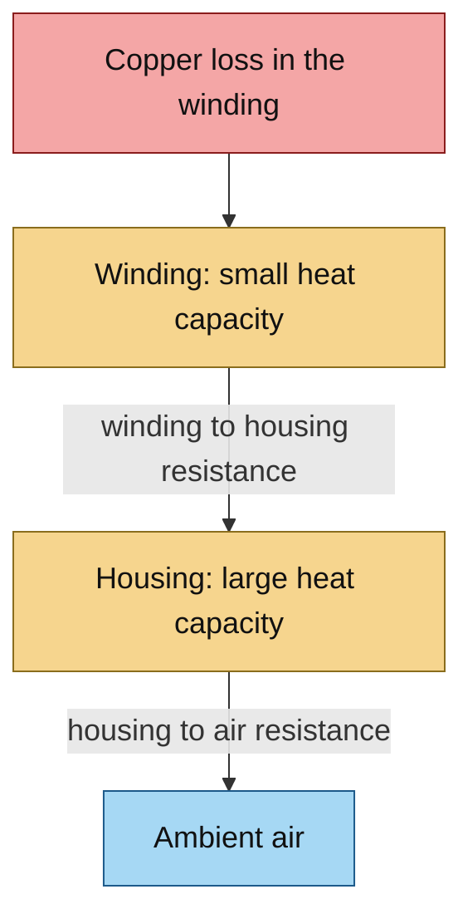

[[index|Home]]

**Scope.** This chapter covers:

- where heat is made in a humanoid, and how it gets out;
- what happens when it cannot get out fast enough, and how the robot should respond;
- the whole-robot energy budget for the tote cycle, broken down by subsystem.

Battery sizing is in [[2.1 - Battery Packs Battery Management and Charging|2.1]]; this chapter supplies the budget it sizes against. Numbers in worked examples are **illustrative estimates** unless a source sits next to them.

## 2.8.1 Purpose and Interfaces

Almost every watt a humanoid draws ends up as heat inside its body. Lifting the tote stores a little energy, and lowering it gives that energy back as heat too. So the energy budget and the heat budget are the same budget seen from two sides: one asks how long the battery lasts, the other whether the robot can get rid of what it uses.

- **Energy:** heat from the motor windings, the drives, the gearboxes, the battery and the compute.
- **Data:** temperature sensors in windings, drives, battery and compute, and thermal models that estimate the temperatures no sensor can reach.
- **Commands and feedback:** derating, meaning reducing the allowed torque or speed as temperature rises; fan or pump control; and thermal warnings to the task layer, so it can change posture, slow down or pause.
- **Timing:** windings heat in seconds, motor housings in minutes, and the battery and torso over tens of minutes.
- **Physical:** the heat paths through the structure, any airflow or coolant routes, and the maximum ambient temperature of the site.

## 2.8.2 Fundamentals

### Where the heat comes from

| Source | Why it heats | When it is worst |
|---|---|---|
| Motor windings | Copper loss, which grows with the square of torque ([[2.4 - Motors and Actuator Selection\|2.4]] §2.4.2) | Holding a load still, crouching under a load |
| Motor drives | Conduction and switching losses in the transistors ([[2.3 - Motor Drives and Power Electronics\|2.3]] §2.3.4) | High current, at any speed |
| Gearboxes | Friction in the gear teeth and bearings ([[2.5 - Transmissions and Joint Modules\|2.5]] §2.5.2) | Fast motion under load |
| Battery | Current through the cells' internal resistance | Fast charging and high draw |
| Compute | Nearly all of its electrical power becomes heat | Always on, in a sealed torso |

The motors dominate when the robot works hard; compute dominates when it stands and thinks. Motor heat is also the most concentrated: a few tens of watts in a winding the size of a hand.

### Heat paths

Heat leaves a component in three ways. **Conduction** carries it through solid parts, from the winding into the housing and the limb structure. **Convection** carries it from a surface into the air, either naturally, as warm air rises, or forced by a fan. **Liquid cooling** pumps a coolant past the hot parts to a radiator elsewhere. Radiation also carries some heat away, but at these temperatures it is a small share.

### Thermal resistance and capacitance

A simple model treats heat like electric current. Temperature difference plays the part of voltage, heat flow the part of current, and two properties describe each part of the path:

- **Thermal resistance** $R_{\text{th}}$, in °C per watt: how many degrees hotter a part runs for each watt flowing through it. A smaller value means a better heat path.
- **Thermal capacitance** $C_{\text{th}}$, in joules per °C: how much heat a part soaks up per degree of temperature rise. A larger value means it heats more slowly.

For one lump, a motor with its housing, heated by copper loss $P$ in an ambient at $T_{\text{amb}}$, the temperature follows

$$
C_{\text{th}} \frac{dT}{dt} = P - \frac{T - T_{\text{amb}}}{R_{\text{th}}}
$$

Qian et al. use this first-order model for each motor of a legged robot, then connect the motors and the onboard computer in a network, because closely packed motors heat each other ([Qian et al., 2026](https://arxiv.org/abs/2603.01631)). Starting at ambient, the solution is

$$
T(t) = T_{\text{amb}} + P R_{\text{th}} \left( 1 - e^{-t / \tau} \right), \qquad \tau = R_{\text{th}} C_{\text{th}}
$$

Two things follow. The **steady temperature rise** is $P R_{\text{th}}$; if that stays below the allowed rise, the joint can hold that load forever. The **time constant** $\tau$ sets how fast it gets there: after one $\tau$ the rise is 63% of its final value, after three it is 95%.

A real motor has at least two lumps: a winding with little heat capacity, and a housing with much more. Urs et al. measured both on an open-source legged-robot actuator ([Urs et al., 2022](https://arxiv.org/abs/2202.12395)), and the diagram below shows that two-lump path.

Colour key: red is where heat is made, yellow the parts that store it, blue where it finally goes.

| Value measured by Urs et al. | With fans | Without fans |
|---|---|---|
| Winding to housing resistance | 0.828 °C/W | 1.09 °C/W |
| Housing to air resistance | 1.44 °C/W | 6.68 °C/W |
| Total resistance | 2.27 °C/W | 7.77 °C/W |
| Winding heat capacity | 15.9 J/°C | 18.4 J/°C |
| Housing heat capacity | 146 J/°C | 138 J/°C |

The winding's time constant, about $0.828 \times 15.9 \approx 13$ s with fans, is why a joint can push hard for a few seconds: the winding heats fast, but a short burst ends before it gets there. The housing's, about $1.44 \times 146 \approx 210$ s with fans and $6.68 \times 138 \approx 920$ s without, is why a sustained load takes minutes to overheat. The authors keep the stator windings below 100 °C "to avoid premature winding thermal failure". Their model predicts that the actuator can carry 9.2 A for 20 s or 22 A for 2 s without passing it.

### Derating

As a winding nears its limit, the drive lowers the current it allows. The joint still works, but weaker or slower. To the task layer that looks like a lift that takes longer, or a load the robot can no longer pick up. If nothing gives way, the drive shuts the joint down to protect it, which for a leg means a fall. Derating is meant to prevent that: lose speed early so the robot does not lose its footing late.

The copper itself makes things worse as it heats. Its resistance rises by about 0.43% per °C (Urs et al. measured 0.51% on their windings), so a winding at 100 °C has about a third more resistance than at 25 °C, and makes about a third more heat for the same torque. Urs et al. use the same effect the other way round: they measure the winding's resistance to infer its temperature, using the motor as its own thermometer.

### Ambient temperature

Everything above is a temperature *rise*. The allowed rise is the limit minus the ambient temperature, so a hot site takes margin directly. With a 100 °C limit, a joint has 75 °C of rise to work with at 25 °C and only 60 °C at 40 °C, a fifth less. Cold works the other way for motors but against the battery, which performs worse in the cold ([[2.1 - Battery Packs Battery Management and Charging|2.1]] §2.1.3).

## 2.8.3 Design Alternatives and Tradeoffs

### Cooling methods

| Method | Heat it can remove | Mass and parts added | Noise | Dust and dirt | Sealing |
|---|---|---|---|---|---|
| Passive (conduction and natural convection) | Lowest | None beyond fins or heat spreaders | Silent | Unaffected | Fully sealable |
| Forced air (fans) | Several times passive | Fans, ducts, filters | Audible | Fans pull dust in; filters clog | Needs openings, which lowers the IP code ([[2.6 - Mechanical Architecture and Structures\|2.6]] §2.6.2) |
| Liquid (pump, coolant, radiator) | Highest per unit volume | Pump, hoses, radiator, coolant | Low at the joint; radiator fan elsewhere | Sealed loop unaffected; radiator still needs air | Joints sealable; hoses must cross moving joints, and leaks are a failure mode |

The table is this library's summary. For the forced-air row, Urs et al. measured about a 3.5-fold reduction in thermal resistance from two small fans, which "nearly doubles the amount of continuous current that can be safely dissipated". They also note that a joint holding a load still does not turn, so a fan driven by the motor itself does nothing; the fans need their own power.

### Placement

Heat sources fight for the same paths. Motors and drives sit in the limbs, where there is little room and air for cooling; the compute, battery and often the power electronics sit in the torso. If the drives are central ([[2.3 - Motor Drives and Power Electronics|2.3]] §2.3.3), they add their heat to the compute's in one sealed box. If they are in the joints, they add it to the motor's in one sealed housing ([[2.5 - Transmissions and Joint Modules|2.5]] §2.5.2). Neither is free. The torso usually has the most surface and the most room for a fan or radiator, so it is where active cooling goes first.

### Holding strategies

Electrically, holding torque is the expensive part: the joint does no work, but the winding heats as if it were lifting. Three ways to avoid paying for it:

- **Posture.** Holding the tote close to the body cuts shoulder copper loss by about five times against holding it at reach ([[2.4 - Motors and Actuator Selection|2.4]] §2.4.4). Standing straighter cuts knee torque the same way.
- **Gear ratio.** A higher ratio holds the same torque with less motor current, at the cost of backdrivability ([[2.5 - Transmissions and Joint Modules|2.5]] §2.5.4).
- **Brakes and locks.** A brake holds a joint with no winding current. It suits long waits in one pose, such as a powered-down robot or an arm parked at a station, but not balance, which needs the joints free to move. A spring-applied brake holds when unpowered, which also makes it useful when a drive faults while holding a load ([[2.3 - Motor Drives and Power Electronics|2.3]] §2.3.5).

## 2.8.4 Sizing or Worked Example

All values are **illustrative estimates** unless marked otherwise.

### How long can a joint hold?

**Model.** One lump per joint, using the candidate actuator and motor values from [[2.4 - Motors and Actuator Selection|2.4]] §2.4.4 ($K_m = 0.516\ \text{N\,m}/\sqrt{\text{W}}$ at the motor, 10:1 gearbox):

- **Thermal resistance:** $R_{\text{th}} = 1.4\ {}^{\circ}\text{C/W}$, chosen so that the candidate's continuous rating of 37.5 N m, 52.8 W of copper loss, gives a steady rise of 74 °C, just reaching 100 °C at 25 °C ambient. For comparison, Urs et al.'s fan-cooled actuator, about a third of the mass, measured 2.27 °C/W.
- **Thermal capacitance:** $C_{\text{th}} = 470\ \text{J/}{}^{\circ}\text{C}$, Urs et al.'s total of 162 J/°C scaled by actuator mass, 1.40 kg against their 0.48 kg.
- **Time constant:** $\tau = 1.4 \times 470 = 658\ \text{s}$, about 11 minutes.
- **Limit:** 100 °C winding temperature, as Urs et al. use.

**Time to the limit** for a held load, from the solution in §2.8.2:

$$
t_{\text{limit}} = -\tau \ln \left( 1 - \frac{T_{\text{max}} - T_{\text{amb}}}{P R_{\text{th}}} \right)
$$

which only has an answer when the steady rise $P R_{\text{th}}$ exceeds the allowed rise. Otherwise the joint can hold indefinitely.

| Held load | Copper loss | Steady rise | At 25 °C ambient | At 40 °C ambient |
|---|---|---|---|---|
| Shoulder, tote carried close (15.7 N m) | 9.3 W | 13 °C | Indefinitely (38 °C) | Indefinitely (53 °C) |
| Shoulder, tote held at the shelf (34.3 N m) | 43 W | 60 °C | Indefinitely (85 °C) | At the limit, no margin |
| Knee, crouched under the tote (58.9 N m) | 128 W | 179 °C | 5.9 min | 4.5 min |

The copper losses are those of [[2.4 - Motors and Actuator Selection|2.4]] §2.4.4. The one-lump model is optimistic in two ways: the winding runs hotter than the housing it is lumped with, and its resistance rises as it heats (§2.8.2). Real times would be shorter.

**What it shows.**

- **Holding close is free, thermally.** The carry posture never comes near the limit, even on a hot day.
- **Holding at reach uses all the margin on a hot day.** At 25 °C the shoulder settles 15 °C below its limit; at 40 °C it has none. A robot that waits at the shelf holding the tote out, for a busy conveyor for instance, should pull it in or set it down.
- **Crouching under load is a timed posture.** The knee has under six minutes, and in a hot building under five. A single 3 s crouch is nothing, but a robot that waits crouched, or a pick that stalls while the robot is bent under the tote, is on a clock.

### Transfers per hour before derating

Over a full cycle, what matters is the average heat. From [[2.4 - Motors and Actuator Selection|2.4]] §2.4.4, a cycle puts 459 J into each shoulder and 708 J into each knee. The steady average temperature stays below the limit while

$$
n \times E_{\text{cycle}} / 3600 \le \frac{T_{\text{max}} - T_{\text{amb}}}{R_{\text{th}}}
$$

where $n$ is cycles per hour. At 40 °C ambient that allows $60 / 1.4 = 42.9\ \text{W}$ per joint.

| Joint | Heat per cycle | Average rise at 60 per hour | Thermal ceiling at 25 °C | Thermal ceiling at 40 °C |
|---|---|---|---|---|
| Shoulder | 459 J | 11 °C | 420 per hour | 336 per hour |
| Knee | 708 J | 17 °C | 272 per hour | 218 per hour |

The target rate is 60 per hour. Lifting and crouching alone use under a third of the knee's thermal room even at 40 °C. What eats the rest is not counted here: walking puts stance torque on the knees for most of every cycle (3.7, Planned), and gearbox and drive losses add to the motor's heat ([[2.5 - Transmissions and Joint Modules|2.5]] §2.5.8).

### Energy budget by subsystem

[[2.1 - Battery Packs Battery Management and Charging|2.1]] §2.1.4 sized the pack on 6.95 Wh per 60 s cycle: 300 W baseline, 1.9 Wh of walking and 0.05 Wh of lift work. It did not count the copper loss of holding the tote or of crouching under it. Adding those from 2.3 and 2.4:

| Item | Basis | Energy per cycle | Share |
|---|---|---|---|
| Baseline | 300 W for 60 s: standing, compute, sensors, cooling (2.1) | 5.00 Wh | 66% |
| Walking | 20 m per cycle (2.1) | 1.90 Wh | 25% |
| Crouch | Both knees, 708 J each (2.4) | 0.39 Wh | 5.2% |
| Holding | Both shoulders: 3 s at the shelf with drive losses, 279 J (2.3), plus 20 s carried close, 370 J | 0.18 Wh | 2.4% |
| Lift work | Raising the tote and arms (2.1) | 0.05 Wh | 0.7% |
| **Total** | | **7.52 Wh** | |

**What it shows.**

- **Holding and crouching add 8%.** The cycle rises from 6.95 Wh to 7.52 Wh, and the average draw from 417 W to 451 W. The 2 h pack of 2.1 grows from 1,043 Wh to 1,128 Wh, or from 7.0 kg to 7.5 kg at 150 Wh/kg.
- **The baseline still dominates.** Two-thirds of the energy goes to being on and upright. Cutting it, through more efficient standing and compute ([[2.10 - Embedded Compute and Real-Time Communications|2.10]] §2.10.4), is still the main lever.
- **All 451 W becomes heat.** The robot has to shed that much heat on average, most of it from the torso and legs, through the paths in §2.8.2.

### Tote hook: sustained transfers per hour

At 60 transfers per hour, the lift-and-crouch heat leaves the joints a large margin, even at 40 °C. The robot is not thermally limited by the transfers themselves; it is limited by **waiting in a loaded posture**. The thermal model should therefore feed the task layer a simple rule: never wait crouched, and never wait with the tote held out. Set it down, pull it in, or stand up.

## 2.8.5 Validation and Failure Modes

### Tests

| Test | What it shows | Pass criterion (example) |
|---|---|---|
| Thermal soak on the duty cycle | Winding, drive, battery and compute temperatures over a full shift of tote cycles | All below their limits at the site's maximum ambient, with margin |
| Worst-case hold | Time to derating in each loaded posture | At least the longest wait the task can produce |
| Thermocouples and thermal imaging | Where the heat actually is, including hot spots the model misses | Measured and modelled temperatures agree |
| Thermal model check | The model's predictions against measurements on a new duty cycle | Error within a stated bound, such as 5 °C |
| Blocked-vent and fan-off test | Behaviour when cooling fails | Robot derates and warns; it does not fall |

Lee et al. note that while "some manufacturers provide information on thermal dynamics", "many omit this information, leaving this characterization to the community" ([Lee et al., 2023](https://arxiv.org/abs/2310.00080)). In practice the builder measures the thermal model.

### Failure modes

| Failure | Cause | How it is detected | Task-layer response |
|---|---|---|---|
| Overtemperature shutdown mid-task | Long hold, hot site, model too optimistic | Temperature reaches the hard limit | Should not happen: derating should come first. If it does, the robot needs a safe stop that does not drop the tote or fall |
| Approaching the limit | Heavy duty cycle, hot day | Temperature or thermal model crossing a warning threshold | Slow down, change posture, or pause to cool; report reduced rate |
| Fan failure | Wear, dust, damage | Fan speed signal; temperatures rising faster than the model predicts | Derate the affected area; schedule service |
| Blocked vents or clogged filters | Dust, packaging, debris | Rising temperatures at normal load | Derate; clean or replace filters |
| Thermal model drift | Wear, changed friction, grease aging | Model and sensors disagree | Trust the sensor; recalibrate the model |
| Coolant leak (liquid systems) | Damaged hose or seal | Pressure or level sensor | Stop heavy work; service before the electronics get wet |

The common thread is that the task layer must hear about heat early, as a reduced capability, not late, as a stopped joint. For a legged robot a stopped joint is a fall.

## 2.8.6 Industry Progress

No humanoid maker found publishes derating curves, thermal limits per joint, or duty-cycle data. What exists is one maker's split between instant and sustained payload, a cooling method on a spec sheet, and research on legged robots.

| Date | Platform | Claim | Evidence stage | Source |
|---|---|---|---|---|
| Undated | Boston Dynamics Atlas | Weight capacity 50 kg instant, 30 kg sustained; operating temperature -20 to 40 °C | Vendor-reported | [Boston Dynamics](https://bostondynamics.com/products/atlas/) |
| Undated | Unitree G1 | "Local air cooling"; internal-rotor motors chosen for "better response speed and heat dissipation" | Vendor-reported | [Unitree](https://www.unitree.com/g1) |
| 2026-03-02 | Unitree A1 quadruped (Qian et al.) | With a 3 kg payload, the standard walking policy "triggers overheat protection and stops within approximately 7 minutes"; a policy that sees motor temperatures runs "for over 27 minutes" | Research; author-measured | [Qian et al.](https://arxiv.org/abs/2603.01631) |
| 2022-02-24 | Open-source legged actuators (Urs et al.) | Winding limit 100 °C; two small fans cut thermal resistance about 3.5 times and nearly double continuous torque | Research; author-measured | [Urs et al.](https://arxiv.org/abs/2202.12395) |

**What this shows.** Atlas's 50 kg against 30 kg is the clearest public hint that a humanoid's payload is limited by heat: it can lift more than it can keep lifting. The page does not say why, so this is an inference. Its 40 °C upper limit is the hot-site case used in §2.8.4. The quadruped result shows the other half: a legged robot that ignores motor temperature stops in minutes under load, and one that adapts its gait to temperature keeps going, at no cost in hardware.

## 2.8.7 Bottlenecks

- **Sealed limbs.** Motors, drives and gearboxes share small sealed housings with no airflow. Opening them for fans lowers the IP code; liquid cooling adds hoses across every joint. No clean answer exists.
- **Sustained heavy work.** Short peaks are easy; holding and crouching under load for a full shift are not. Atlas's own split between instant and sustained payload shows the gap.
- **Thermal models.** Makers rarely publish thermal data, so every builder measures its own, and models drift as the robot wears.

## 2.8.8 Implications for the Tote Transfer Example

- **The rate is sustainable.** At 60 transfers per hour, lifting and crouching use under a third of the knee's thermal room at 40 °C (§2.8.4). Walking adds load not yet counted (3.7, Planned).
- **Waiting is the risk.** Crouching under the tote reaches the knee's limit in about five minutes; holding it at reach uses all the shoulder's margin on a hot day. The task layer needs the rule: never wait loaded.
- **Budget 7.5 Wh per cycle, not 7.0.** Holding and crouching add 8% to the energy, and to the pack.
- **Simpler alternative.** A conveyor or a fixed robot cell is bolted to the floor, so it pays nothing for balance and never crouches under the load.

## Related Notes

- [[index|Home]]
- Previous: [[2.7 - Hands Grippers and End Effectors|2.7 Hands, Grippers, and End Effectors]]
- [[1.4 - How a Humanoid Works - The Full System Map|1.4]] §1.4.2 (energy overview); [[2.1 - Battery Packs Battery Management and Charging|2.1]] §2.1.4 (pack sizing); [[2.4 - Motors and Actuator Selection|2.4]] §2.4.4 (joint heat per cycle)
- [[Glossary]] · [[Source Index]]
- Next: [[2.9 - Sensors Calibration and Time Synchronization|2.9 Sensors, Calibration, and Time Synchronization]]
- Deeper treatment: [[2.10 - Embedded Compute and Real-Time Communications|2.10 Embedded Compute and Real-Time Communications]]; 3.3 Joint-Level Control and Actuator Characterization, 3.7 Balance, Locomotion, and Whole-Body Control (both Planned)

## Sources

- Urs, K., Enninful Adu, C., Rouse, E. J. and Moore, T. Y. (2022). Design and Characterization of 3D Printed, Open-Source Actuators for Legged Locomotion. arXiv:2202.12395. https://arxiv.org/abs/2202.12395 ([[Source Note - Urs 2022 Open-Source 3D Printed Actuators for Legged Locomotion]])
- Qian, L., Wan, Y., Wang, S. and Luo, X. (2026). Learning Thermal-Aware Locomotion Policies for an Electrically-Actuated Quadruped Robot. arXiv:2603.01631. https://arxiv.org/abs/2603.01631 ([[Source Note - Qian 2026 Thermal-Aware Locomotion for a Quadruped]])
- Lee, U. H. et al. (2023). How to Model Brushless Electric Motors for the Design of Lightweight Robotic Systems. arXiv:2310.00080. https://arxiv.org/abs/2310.00080 ([[Source Note - Lee 2023 How to Model Brushless Electric Motors]])
- Boston Dynamics. Atlas product page. https://bostondynamics.com/products/atlas/ ([[Source Note - Boston Dynamics 2026 Atlas Product Pages]])
- Unitree Robotics. G1 product page. https://www.unitree.com/g1 ([[Source Note - Unitree G1 Product Page]])
